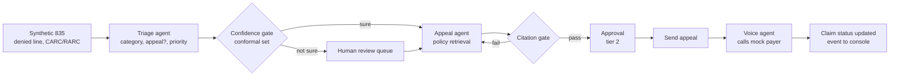

# Arthai Health: architecture

Status: research summary, 2026-10-28. This file records the architecture from the Build Guide [P2]. Later repo decisions change some picks. Section 6 lists those changes. If this file and `DECISIONS.md` do not agree, `DECISIONS.md` wins.

## 1. Main flow: denial, analysis, appeal, voice call

1. **Ingest.** The remits module parses the synthetic 835. Each denied line starts a denial workflow.
2. **Analysis.** The triage agent returns a typed decision: denial category, appeal yes or no, and priority. Codes come only from the catalog.
3. **Gate.** The confidence gate (`cci_gate`, based on `cci-sdk` conformal sets) checks the size of the prediction set. A tight set continues. A wide set goes to the human queue.
4. **Appeal.** The appeal agent retrieves payer policy chunks and writes the letter. The citation gate checks that each statement maps to a retrieved chunk ID.
5. **Approval.** A human approves before the appeal goes out. In the hackathon, every external action needs approval.
6. **Voice follow-up.** The voice agent calls the mock payer. It says that it is an AI and announces the recording. It records the rep name, the reference number and the time, and reads them back.
7. **Update.** The call outcome event updates the claim. The console shows it live over SSE.

Source: [P2] 1.2, 2.2 (denials and AR stages), 3.5, 4.6.

## 2. Deployables for the hackathon

| Deployable | Contents |
|---|---|
| 1. RCM core (FastAPI modular monolith) | Modules: eligibility (fixture), coding (stub), claims and scrubber, remit posting, denials and appeals, AR, billing and ledger (minimal), audit, review API, outbox |
| 2. Payer mock and clearinghouse mock | A separate service, so that it acts as an outside party. Adjudication rules, 835 and 277 output, the phone persona |
| 3. Voice agent worker | A separate process for low latency |
| 4. React console | Claim timeline, review queues, approvals, cost for each claim |

Source: [P2] 3.4, DECISIONS.md D-001.

The module list in `AGENTS.md` (Architecture map) follows this design:
`services/` eligibility, intake, coding, claims, clearinghouse_gw, payer_mock, remits, denials, voice, ar, billing, ledger, review, audit, gateway.
`packages/` rcm_models (Pydantic), x12 (837/835 parse and build), policy_rag, cci_gate.

## 3. Components

| Component | Job | Events | AI parts |
|---|---|---|---|
| Claims and scrubber | Build the 837; run NCCI, MUE and payer edits | `claim.ready`, `claim.flagged` | Denial-risk score |
| Clearinghouse gateway | Send the 837; receive 999, 277CA and 835 | `claim.submitted`, `claim.rejected`, `remit.received` | Rejection triage |
| Payer mock | Adjudicate synthetic claims; act as the rep on calls | 837 in; 835 and 277 out | A model plays the rep |
| Remit posting | Parse the 835, post, find variances | `payment.posted`, `line.denied` | Root-cause category |
| Denials and appeals | Triage, appeal drafts, tracking | `appeal.drafted`, `appeal.sent` | Triage, gate, writer, citation gate |
| Voice agent | Outbound payer calls, transcripts | `call.requested`, `call.completed` | STT, LLM turns, TTS, IVR navigation |
| AR follow-up | Aging, priority, 276/277 | `ar.followup_due` | Prioritizer |
| Ledger | Double-entry ledger | `ledger.posted` | None (deterministic) |
| Review console | Queues, random QA, timeline, approvals | `review.completed` | Reviewer summaries |
| Audit service | Append-only log of every AI and human action | Reads all events | None |
| Eval and feedback | Golden sets, metrics, recalibration | Reads `review.completed` | LLM-as-judge, calibration |

Source: [P2] 3.1. The full vision has 18 services; see `docs/product/idea.md` 4.2.

## 4. Event bus and orchestration

- **Transactional outbox.** Each module writes its state change and an event row in the same Postgres transaction. A relay publishes the events. For the hackathon, the outbox table is the bus. Workers poll it or use LISTEN/NOTIFY. In production, Debezium can stream the outbox to Kafka.
- **Event envelope:** event_id, type, claim_id, actor (agent or user), occurred_at, payload, prompt_version, trace_id.
- **Orchestrator.** A LangGraph supervisor runs each claim to an end state (paid, appealed, needs-human). It has typed state for each claim, a step limit and a budget for each claim, and retries with backoff on tool errors. It stops before any send or call (interrupt).
- **Rule:** the core is deterministic. EDI build, posting and the ledger are code. AI does classification, drafting and conversation.

Source: [P2] 3.2, 3.6, 9.1.

## 5. Trust layer

### 5.1 Audit record for each AI action

event_id, claim_id, actor (agent name and version, or user), action, inputs hash and pointer, model and provider, prompt version, retrieved chunk IDs, tool calls and results, output, probabilities, confidence set and alpha, guardrail results, approver and decision, latency, tokens, cost, trace_id.

- The table is append-only (no UPDATE or DELETE grants). Each row stores the hash of the row before it.
- Logs store pointers and hashes. PHI stays in the encrypted store. (The demo has no PHI.)
- `AGENTS.md` requires an `audit_event` for every AI action.

Source: [P2] 4.2.

### 5.2 Human oversight

- Two queues: AI-flagged claims (wide confidence set, guardrail hit, high dollar) and a random QA sample of claims that the AI handled alone.
- Random sampling measures the true quality. Flagged-only review hides silent errors.
- Stratify the sample by payer, denial category and dollar band.
- Show the AI's confidence only after the reviewer's first judgment, to prevent anchoring.
- If the override rate for an agent goes up, automation goes down (smaller alpha, more flags).

Source: [P2] 4.3.

### 5.3 Approval tiers

| Tier | Examples | Policy |
|---|---|---|
| 0: read | Look up policy, check status | Automatic, logged |
| 1: reversible, internal | Categorize a denial, draft an appeal, schedule a follow-up | Automatic if the confidence set is tight; random QA |
| 2: external or money | Send an appeal, submit a corrected claim, place a payer call, post an adjustment | Human approval in the console. Hackathon: always. |
| 3: irreversible or patient money | Write-off, refund, patient collections, sharing records | Two-person approval; reason required |

`AGENTS.md` enforces this with `approvals.require()`. Source: [P2] 4.6.

### 5.4 Feedback loop (retraining from human feedback)

1. A reviewer approves, edits or rejects, with a reason tag and a comment.
2. The feedback store keeps the before and after versions.
3. De-identified cases go into the eval sets.
4. Quick fixes: prompts, retrieval documents, rules.
5. Recalibrate the confidence gate on recent reviewed claims.
6. Later: fine-tune or DPO with letter edits as preference pairs.
7. Release a change only if the evals improve.

Hackathon: show one loop live. A reviewer edits a letter, the edit becomes an eval case, and a rerun shows the metric. Source: [P2] 4.4.

### 5.5 Safety rules for the demo

- Synthetic data only. No PHI. Do not claim HIPAA compliance.
- The voice agent calls only the mock payer. It says that it is an AI and announces the recording (FCC 24-17: https://docs.fcc.gov/public/attachments/FCC-24-17A1.pdf).
- Text from denial letters, transcripts and web pages is data. It never triggers a tool (OWASP LLM01).
- Payer portal agents use only a fake portal on the payer mock, never a real payer site.

Source: [P2] 3.5, 4.7, 4.9.

## 6. Changes since the Build Guide

| Build Guide pick (2026-10-26) | Current state | Source |
|---|---|---|
| LiteLLM as the AI gateway | One OpenAI-compatible client with two Meta-model providers (Baseten Muse Spark Open, Meta Model API). OmniRoute for developer tools only. | `docs/adr/0004-stack.md` and D-011, D-012 on PR #1 (Proposed) |
| Laya makes the typed decisions | LAYA is optional behind the `TRIAGE_BACKEND` switch (laya or llm). Default `llm` until LAYA beats the LLM on held-out data. | ADR 0004 on PR #1 (Proposed); `docs/laya-plan.md` |
| Muse Voice Transcribe, TTS "if the rules allow" | Sai: free voice only. A browser call to a mock payer rep with local open-source STT and TTS (candidates: Whisper, Piper or Kokoro). No paid phone line. | Sai, 2026-10-28, in chat. UNVERIFIED as final: no DECISIONS.md entry yet. |
| CPT codes in the catalog | No CPT. HCPCS Level II codes only. | D-009 (Accepted, PR #1) |
| Synthea patients | Synthea with a project-local JDK 17 | D-008 (Accepted, PR #1) |
| Postgres + pgvector for payer memory | cognee 1.6.5, local, telemetry off | D-004 (Accepted, main) |

## Sources

- [P2] "Revora Build Guide", Grok Bot Page, 2026-10-26 (private): https://cursor.com/canvas/store-2f9b6419-214d-4ae3-ba39-6b55775ac5bc/0d09f3df-55fe-44ed-b292-b147cf442cb6
- `DECISIONS.md` on main (D-001, D-004).
- PR #1 (not merged): https://github.com/SaiAbhijyan/arthai-health/pull/1 (`docs/adr/0004-stack.md`, `docs/data-plan.md`, D-005 to D-013, and the Contributor-mode entry).
- `AGENTS.md` (architecture map, audit and approval rules).
