> Verbatim snapshot of the "Revora Build Guide" research page as of Oct 26, 2026. Not maintained. See [README](README.md) for what was changed for the public repo.

# Revora Build Guide

*Revora: AI agents that get you paid. A book for Revora, Sai's AI-powered RCM suite: the vision, the domain, every product and service, the trust layer (security, audit, oversight, feedback), edge cases, demo infrastructure and the market. How to build and review the code lives in the primary doc, the Elite Builder Playbook.*

> [!NOTE]
> **Start with the primary doc: Elite Builder Playbook**
>
> All development follows the Elite Builder Playbook (review checklists, verification loops, prompts, rules files): https://cursor.com/canvas/store-2f9b6419-214d-4ae3-ba39-6b55775ac5bc/b7d4e5e1-54f1-46ce-b2af-97c24289a648

- [0. Meta Hackathon Brief (read first)](https://cursor.com/canvas/store-2f9b6419-214d-4ae3-ba39-6b55775ac5bc/3ae4ac4c-0964-4471-83cb-753724da2f24) (cursor.com)
- [1. Elite Builder Playbook (PRIMARY doc)](https://cursor.com/canvas/store-2f9b6419-214d-4ae3-ba39-6b55775ac5bc/b7d4e5e1-54f1-46ce-b2af-97c24289a648) (cursor.com)
- [2. Revora: Idea & Products](https://cursor.com/canvas/store-2f9b6419-214d-4ae3-ba39-6b55775ac5bc/80ce4a4b-2037-4660-a261-d5602478fcf4) (cursor.com)
- [3. RCM Landscape: Who Won & Why](https://cursor.com/canvas/store-2f9b6419-214d-4ae3-ba39-6b55775ac5bc/aecd7038-617d-4b7d-b2a9-2723200ba3e1) (cursor.com)

**Contents**

- [Part I. Vision and the case](#p1)
  - [1.1 The vision](#v)
  - [1.2 Takeaways](#tk)
  - [1.3 Key metrics](#km)
- [Part II. The RCM domain](#p2)
  - [2.1 RCM end to end](#s1)
  - [2.2 Stage-by-stage AI workflow](#s7)
  - [2.3 Edge cases and mitigations](#ec)
- [Part III. Product suite and architecture](#p3)
  - [3.1 Applications and services](#svc)
  - [3.2 System diagram and event bus](#sys)
  - [3.3 Control plane and oversight console](#cp)
  - [3.4 How many to build](#cnt)
  - [3.5 Hackathon build](#s5)
  - [3.6 AI architecture concepts](#s9)
  - [3.7 Token cost per claim](#tok)
- [Part IV. Trust layer](#p4)
  - [4.1 Security](#sec)
  - [4.2 Audit trail of AI actions](#aud)
  - [4.3 Human oversight](#ovs)
  - [4.4 Feedback loop](#fb)
  - [4.5 Context and memory](#ctx)
  - [4.6 Approvals for high-risk actions](#apr)
  - [4.7 Safe browsing agents for payer portals](#brw)
  - [4.8 Invoices and accounts](#acct)
  - [4.9 Compliance by stage](#s8)
- [Part V. Demo infrastructure](#s6)
- [Part VI. Market and research (moved to Landscape page)](#p6)
- [Part VII. Building it](#p7)
  - [7.1 Elite Builder Playbook (primary)](#pb)
  - [7.2 REA: Reverse Engineer Anything](#s4)
- [Part VIII. How it's done at a company](#p8)
  - [8.1 Team roles](#roles)
  - [8.2 SDLC, environments and change management](#sdlc)
  - [8.3 Operations: on-call, incidents, SLOs](#ops)
  - [8.4 Security and compliance programs](#prog)
  - [8.5 Rolling out AI in an enterprise](#roll)
  - [8.6 Prioritizing and selling it (moved)](#sell)
- [Part IX. Explaining it in interviews](#p9)

## Part I. Vision and the case

### 1.1 The vision

A suite of AI-powered products covering the whole revenue cycle, from scheduling to the ledger. Every AI action is secured and lands in an immutable audit trail. Humans can open any claim at random for QA, and the AI flags the claims it's unsure about. Reviewer corrections and comments feed a loop that improves prompts, retrieval, calibration and eventually the models.

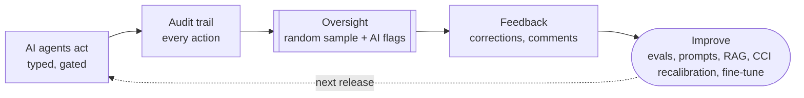

### 1.2 Takeaways

> [!NOTE]
> **Your opening: calibrated abstention plus a closed voice loop**
>
> Vendors sell automation rates. None of the marketing I read shows a conformal guarantee on when a claim goes to a human, or a payer call whose outcome updates the claim live. Laya, CCI and Muse cover both.

1. Denials start upstream. Top causes: missing or inaccurate claim data (50%), authorizations (35%), registration errors (32%) ([Experian 2025](https://www.experian.com/content/dam/noindex/na/us/healthcare/state-of-claims-2025.pdf)).
2. Reworking a denial costs about $103, versus $6.50 to submit a claim ([HFMA deck 2025](https://www.hfma.org/wp-content/uploads/2025/10/fromregistrationtoreimbursement-fallconf2025-greaterheartland.pdf)). 90% of denials still get human review ([Experian PR](https://www.experianplc.com/newsroom/press-releases/2025/experian-health-s-3rd-annual-state-of-claims-survey-finds-denial)).
3. Raw LLMs are poor coders. GPT-4 got only 33.9% exact on ICD-10-CM ([NEJM AI 2024](https://ai.nejm.org/doi/full/10.1056/AIdbp2300040)). Codes should come from a constrained catalog plus a verifier, which is Laya plus CCI's job.
4. Startups each own one slice: payer calls (Infinitus), payer-side prior auth (Anterior, Cohere), coding (CodaMetrix, Fathom, SmarterDx), denials and AR (Adonis, AKASA, Candid).
5. Demo slice: denied 835 line, then Laya decision, then CCI set, then a grounded Muse appeal, then a live call to a mock payer, then the dashboard updates. Synthetic data only.
6. Build a modular monolith with 4 deployables for the hackathon (Part III); the full suite has 18 services.

### 1.3 Key metrics

*Kodiak 2025 benchmarks via HealthLeaders; Experian State of Claims 2025; HFMA chapter deck 2025; CAQH Index 2024*

| Value | Metric | Detail |
| --- | --- | --- |
| 11.6% | Avg initial denial rate (2025) | up from 11.4%, per Kodiak |
| 52.6 | Median days in AR | down from 54.9, per Kodiak |
| $48.4B | Net revenue leakage 2025 | Kodiak |
| 41% | Providers with ≥10% denials | Experian 2025 (30% in 2022) |
| $103 | Cost to rework a denial | vs $6.50 to submit, per HFMA deck |
| $20B | Admin automation opportunity | CAQH; $11.7B of it in eligibility |

| Metric | Figure | Source |
| --- | --- | --- |
| Medicare Advantage vs traditional Medicare initial denials | 10.1% vs 4.2% | [Kodiak / HealthLeaders](https://www.healthleadersmedia.com/revenue-cycle/cash-flow-improves-despite-484-billion-revenue-leakage-2025) |
| Average time to insurance payment | 55.2 days | [Kodiak / HealthLeaders](https://www.healthleadersmedia.com/revenue-cycle/cash-flow-improves-despite-484-billion-revenue-leakage-2025) |
| Point-of-service collections, median vs top quartile | 16.4% vs 28.4% | [Kodiak / HealthLeaders](https://www.healthleadersmedia.com/revenue-cycle/cash-flow-improves-despite-484-billion-revenue-leakage-2025) |
| Benchmark targets | Denials <5%, clean claims ≥98%, overturns >60% | [HFMA chapter deck](https://www.hfma.org/wp-content/uploads/2025/10/fromregistrationtoreimbursement-fallconf2025-greaterheartland.pdf) |
| Time saved per visit with full automation | 70 min | [CAQH Index 2024](https://www.caqh.org/hubfs/Index/2024%20Index%20Report/CAQH%5FIndexReport%5F2024%5FFINAL.pdf) |
| Cost to collect | Not found in a primary 2025 source; check HFMA MAP Keys | n/a |

## Part II. The RCM domain

### 2.1 RCM end to end

*X12: 270/271 eligibility, 278 prior auth, 837 claim, 276/277 status, 835 remittance (ERA) carrying CARC/RARC codes*

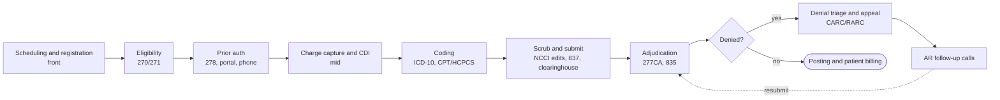

| Stage | What breaks | Where AI fits |
| --- | --- | --- |
| Scheduling and registration | Registration errors are the #3 denial cause (32%) | Voice or chat intake (your Tekcel work), insurance card OCR, field validation |
| Eligibility and benefits | 271 responses often lack details, so someone calls; CAQH sizes this at $11.7B | Auto 270/271, voice agent for missing benefit details (the Infinitus model) |
| Prior auth | Authorizations are the #2 denial cause (35%) | LLM over payer policy, packet assembly, status calls |
| Charge capture and CDI | Missed charges and missing documentation specificity | LLM chart-gap detection (SmarterDx, Fathom) |
| Coding | Code errors cause 24% of denials; LLMs fabricate codes | Constrained classification plus a verifier |
| Scrub and submit | Missing or inaccurate data is the #1 cause (50%) | Pre-submission denial-risk score (Deep Claim) |
| Adjudication and ERA posting | Unmatched payments, paper remits | Auto-posting, mapping CARC/RARC to root cause |
| Denials and appeals | About $103 per rework | Typed decision (appeal? category? priority?) plus a grounded appeal letter |
| AR follow-up | Hold times and IVR trees; Infinitus calls average 34.5 minutes | Voice agent that writes the outcome back to the claim |
| Patient billing | Low point-of-service collections | Estimates, payment-plan chat |

### 2.2 Stage-by-stage AI workflow

*Mermaid isn't supported on this page, so each flow is drawn with the kit's diagram. Pick a stage.*

#### Scheduling and eligibility

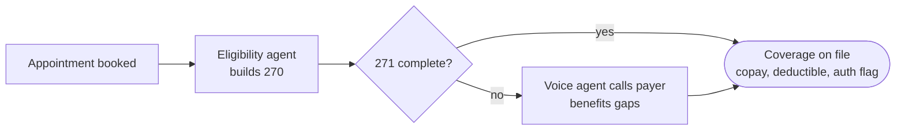

| Field | Value |
| --- | --- |
| AI agents | Eligibility agent (270 builder, 271 parser), benefits-gap voice agent, prior-auth flagger |
| RAG sources | Payer benefit rules and prior-auth lists per CPT |
| Harness and evals | Golden 271 fixtures; field-extraction accuracy; did the call fill every missing field |
| Models | Laya: needs auth? needs call? Muse Spark for call reasoning, Muse Voice Transcribe |
| Orchestration | LangGraph node; async wait on the voice call; resumes on the outcome event |
| Compliance | Minimum necessary: send only member ID, DOB, name and service type. 270/271 is a HIPAA standard transaction (X12 005010X279A1). |
| Hackathon demo | Stedi test-mode eligibility API or a hand-written 271 fixture |

#### Patient registration

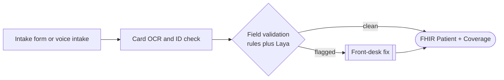

| Field | Value |
| --- | --- |
| AI agents | Intake agent (chat or voice), insurance-card extractor, demographic validator |
| RAG sources | Payer ID directory, address and NPI lookups |
| Harness and evals | Synthea patients with injected errors (bad DOB, swapped subscriber); catch rate |
| Models | Muse Spark for extraction (vision), Laya for 'is this registration denial-prone?' |
| Orchestration | Deterministic validators first, LLM only for fuzzy fields |
| Compliance | Notice of Privacy Practices acknowledgment, consent capture, encrypt card images at rest, log every view. |
| Hackathon demo | Write FHIR Patient/Coverage into HAPI FHIR; never upload real cards |

#### Coding

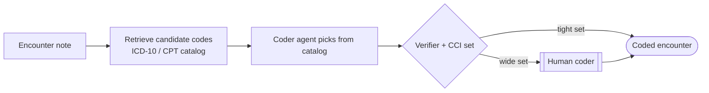

| Field | Value |
| --- | --- |
| AI agents | Coder agent, verifier agent, CDI query agent |
| RAG sources | ICD-10-CM / HCPCS catalogs, NCCI edits, coding guidelines |
| Harness and evals | Exact-match and hierarchical near-miss rate; conformal coverage vs alpha |
| Models | Laya typed choice over catalog; Muse for the rationale only |
| Orchestration | Retrieve, choose, verify, gate. No free-text code generation (NEJM AI 33.9% result) |
| Compliance | Minimum necessary inside the workforce: coder sees the encounter, not the full chart. |
| Hackathon demo | Synthea notes plus a small code subset |

#### Charge and claim creation

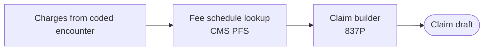

| Field | Value |
| --- | --- |
| AI agents | Charge capture agent, claim builder (deterministic) |
| RAG sources | Fee schedules, payer-specific modifiers |
| Harness and evals | 837 validates against the 005010X222A1 schema |
| Models | No LLM needed to build EDI; keep it deterministic |
| Orchestration | Pure function node; LLM only explains missing data |
| Compliance | 837 is a HIPAA standard transaction; use NPI, taxonomy and code sets exactly as specified. |
| Hackathon demo | Generate 837P from Postgres with a Python X12 library |

#### Scrubbing

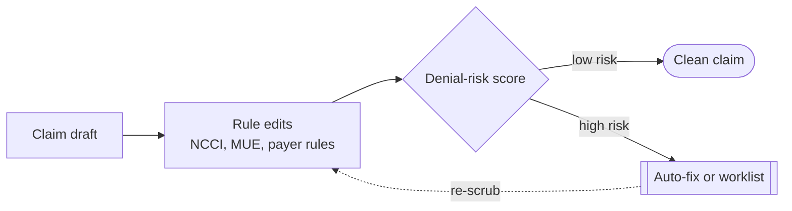

| Field | Value |
| --- | --- |
| AI agents | Scrubber agent, denial-risk predictor, fix-suggestion agent |
| RAG sources | NCCI PTP and MUE tables, payer policy PDFs |
| Harness and evals | Precision at fixed recall on held-out synthetic denials |
| Models | Laya for risk and category; CCI for 'send to human' |
| Orchestration | Rules before model; model output becomes a typed worklist item |
| Compliance | Audit each auto-fix with before/after values and who/what changed it. |
| Hackathon demo | NCCI files from CMS; seeded bad claims |

#### Submission and clearinghouse

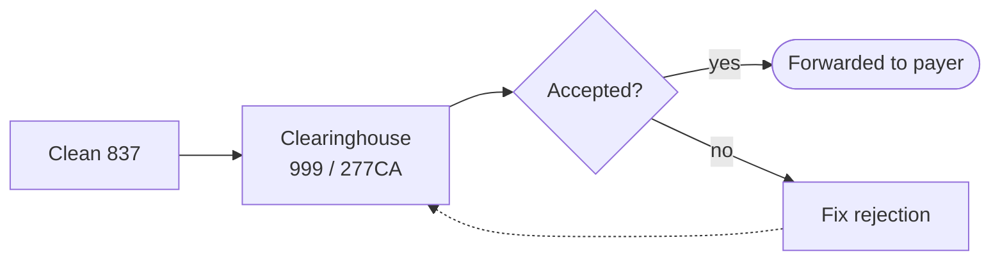

| Field | Value |
| --- | --- |
| AI agents | Submission agent, rejection triage agent |
| RAG sources | Clearinghouse edit messages, payer ID list |
| Harness and evals | Replay 999/277CA fixtures; time to fix |
| Models | Laya for rejection category; Muse explains the fix |
| Orchestration | Event-driven: an ack arrives, the graph wakes up |
| Compliance | Clearinghouse is a BAA partner (or itself a covered entity). TLS in transit, SFTP/AS2 or API. |
| Hackathon demo | Mock clearinghouse FastAPI service or Stedi test mode |

#### Payer adjudication

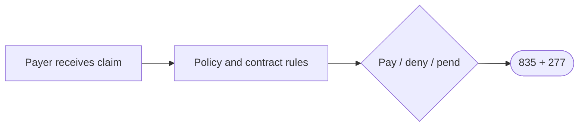

| Field | Value |
| --- | --- |
| AI agents | Mock payer agent (the counterpart your voice agent calls) |
| RAG sources | Synthetic payer policy and contract rates |
| Harness and evals | Deterministic outcomes per seed so demos repeat |
| Models | Muse plays the payer rep on calls; rules decide payment |
| Orchestration | Separate service so it looks like an outside party |
| Compliance | Synthetic data only; label it as a mock payer. |
| Hackathon demo | Build this. No public payer sandbox adjudicates arbitrary claims |

#### Remits and 835 posting

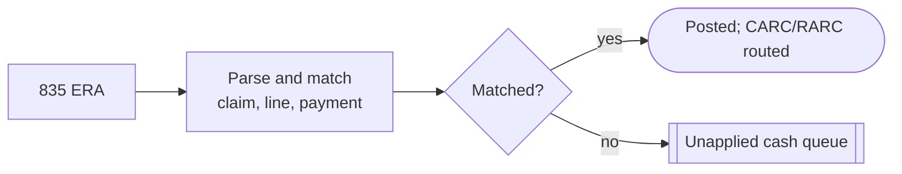

| Field | Value |
| --- | --- |
| AI agents | Posting agent, variance agent (paid vs expected) |
| RAG sources | CARC/RARC code lists, contract rates |
| Harness and evals | Posting accuracy to the cent; underpayment detection rate |
| Models | Deterministic posting; Laya for root-cause category |
| Orchestration | Each denied line spawns a denial subgraph |
| Compliance | 835 is a HIPAA standard (005010X221A1). Keep the raw file immutable for audit. |
| Hackathon demo | Generate 835s from the mock payer |

#### Denials and appeals

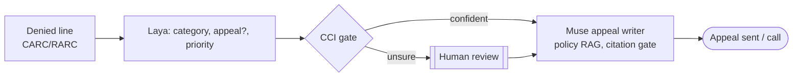

| Field | Value |
| --- | --- |
| AI agents | Triage agent, evidence gatherer, appeal writer, citation checker |
| RAG sources | Payer policy PDFs, denial letter, chart excerpts, CMS appeal levels |
| Harness and evals | Citation-violation rate, coverage of CCI sets, rubric-scored letters |
| Models | Laya decisions; Muse Wonder for long letters; Muse Spark for checks |
| Orchestration | LangGraph with an interrupt for human approval before send |
| Compliance | Disclose only records needed for the appeal; log every disclosure. |
| Hackathon demo | Your core slice |

#### AR follow-up

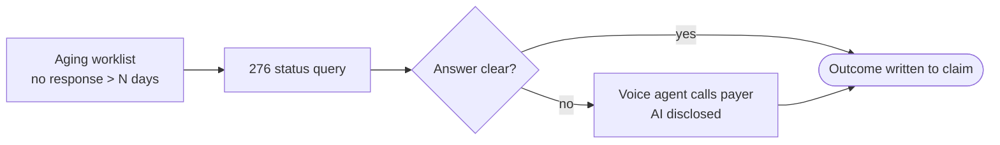

| Field | Value |
| --- | --- |
| AI agents | AR prioritizer, status agent, voice caller, note writer |
| RAG sources | Payer IVR maps, call scripts, previous call notes |
| Harness and evals | Call success rate, fields captured, hallucinated reference numbers = 0 |
| Models | Muse Voice Transcribe (STT), Muse Spark, a TTS if rules allow |
| Orchestration | Long-running call node streaming transcript over SSE |
| Compliance | AI disclosure, recording consent, verify identity before sharing PHI on calls. |
| Hackathon demo | Only call your mock payer |

#### Patient invoicing and account updates

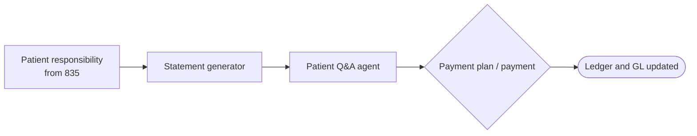

| Field | Value |
| --- | --- |
| AI agents | Statement writer, billing Q&A agent, reconciliation agent |
| RAG sources | Patient ledger, EOB, financial assistance policy |
| Harness and evals | Balance math checked against ledger; tone and clarity rubric |
| Models | Muse for plain-language explanations; ledger math in code |
| Orchestration | Ledger writes are deterministic, idempotent transactions |
| Compliance | No Surprises Act good-faith estimates for self-pay; PCI DSS for cards (use a processor, never store PANs). |
| Hackathon demo | Fake ledger; no real payments |

| Stage | Agents | Models | Demo approach |
| --- | --- | --- | --- |
| Scheduling and eligibility | Eligibility agent (270 builder, 271 parser), benefits-gap voice agent, prior-auth flagger | Laya: needs auth? needs call? Muse Spark for call reasoning, Muse Voice Transcribe | Stedi test-mode eligibility API or a hand-written 271 fixture |
| Patient registration | Intake agent (chat or voice), insurance-card extractor, demographic validator | Muse Spark for extraction (vision), Laya for 'is this registration denial-prone?' | Write FHIR Patient/Coverage into HAPI FHIR; never upload real cards |
| Coding | Coder agent, verifier agent, CDI query agent | Laya typed choice over catalog; Muse for the rationale only | Synthea notes plus a small code subset |
| Charge and claim creation | Charge capture agent, claim builder (deterministic) | No LLM needed to build EDI; keep it deterministic | Generate 837P from Postgres with a Python X12 library |
| Scrubbing | Scrubber agent, denial-risk predictor, fix-suggestion agent | Laya for risk and category; CCI for 'send to human' | NCCI files from CMS; seeded bad claims |
| Submission and clearinghouse | Submission agent, rejection triage agent | Laya for rejection category; Muse explains the fix | Mock clearinghouse FastAPI service or Stedi test mode |
| Payer adjudication | Mock payer agent (the counterpart your voice agent calls) | Muse plays the payer rep on calls; rules decide payment | Build this. No public payer sandbox adjudicates arbitrary claims |
| Remits and 835 posting | Posting agent, variance agent (paid vs expected) | Deterministic posting; Laya for root-cause category | Generate 835s from the mock payer |
| Denials and appeals | Triage agent, evidence gatherer, appeal writer, citation checker | Laya decisions; Muse Wonder for long letters; Muse Spark for checks | Your core slice |
| AR follow-up | AR prioritizer, status agent, voice caller, note writer | Muse Voice Transcribe (STT), Muse Spark, a TTS if rules allow | Only call your mock payer |
| Patient invoicing and account updates | Statement writer, billing Q&A agent, reconciliation agent | Muse for plain-language explanations; ledger math in code | Fake ledger; no real payments |

Cross-cutting harness: one Postgres audit table per decision (input hash, model, version, probabilities, CCI set, human override), a replayable fixture suite of synthetic claims, and dashboard metrics for $ and tokens per claim.

### 2.3 Edge cases and mitigations

*Rules cited where a primary source was checked; others are standard billing practice and should be confirmed per payer.*

| Side | Edge case | Mitigation |
| --- | --- | --- |
| Patient | Coverage changed or terminated between booking and visit | Re-run 270/271 within 24 to 72 hours of service and at check-in; block claim build if inactive |
| Patient | Wrong subscriber, dependent or DOB | Validator compares card, 271 and registration; flag mismatches to front desk |
| Patient | Self-pay or uninsured | Good-faith estimate under the [No Surprises Act](https://www.cms.gov/nosurprises); financial-assistance screen |
| Patient | Disputes a bill or asks to speak to a human | Q&A agent hands off; account placed on hold; no collections action while disputed |
| Provider | Missing documentation or unsigned note | CDI query agent asks the provider; claim held, not guessed |
| Provider | Credentialing or enrollment gap with payer | Check provider-payer enrollment table before submission |
| Prior auth | Service needs auth that wasn't obtained | Auth flag at scheduling; scrubber blocks; retro-auth workflow if payer allows |
| Coding | Hallucinated or non-existent code | Codes only from catalog lookup; verifier; CCI set gates to a human coder |
| Coding | NCCI or MUE conflicts, missing modifiers | Deterministic NCCI/MUE edits before submission |
| Timely filing | Claim near the payer's filing limit | Deadline per payer in the claim record; alert at thresholds; Medicare's limit is 12 months from service ([42 CFR 424.44](https://www.ecfr.gov/current/title-42/chapter-IV/subchapter-B/part-424/subpart-C/section-424.44)) |
| COB | Two payers; wrong primary billed | COB check from 271 and patient questionnaire; Medicare rules via [CMS COB](https://www.cms.gov/medicare/coordination-benefits-recovery/overview) |
| Secondary claims | Secondary needs primary's 835 data | Auto-build secondary 837 with primary adjudication (loop 2320/2430) after posting |
| Partial payments | Paid less than expected | Variance agent compares to contract rate; underpayment worklist and appeal |
| Recoupments | Payer takes back money (negative lines, PLB adjustments in 835) | Posting handles negatives and PLB; link to original claim; alert finance |
| Duplicates | Same claim sent twice; duplicate denial (CARC 18) | Idempotency key per claim version; corrected claims use frequency code 7, not resubmission |
| Clearinghouse | 999 or 277CA rejection; outage | Rejection triage; retry queue with backoff; switch to manual upload runbook |
| Payer | Pended for records | Attachment workflow; tracked deadline |
| Payer | Policy changed mid-year | Policy RAG with effective dates; cite version in appeals |
| Write-offs | Small balances or contractual adjustments | Rules by CARC group (CO vs PR); any discretionary write-off needs approval tier 2 |
| No Surprises Act | Out-of-network surprise billing | Flag NSA-protected services; bill patient only in-network cost-share |
| Voice | IVR menus, long holds, dropped calls, transfers | IVR maps per payer; hold detection; callback scheduling; resume script with call reference |
| Voice | Rep gives wrong or conflicting info | Capture rep name, reference number, timestamp; confirm by reading back; cross-check with 276/277 |
| Voice | Rep asks for info the agent shouldn't share | Minimum-necessary script; agent escalates rather than improvising |
| AI | Prompt injection in uploaded documents, denial letters or transcripts | Treat as data; no tool calls from untrusted text; Prompt Guard; see [OWASP LLM01](https://genai.owasp.org/llmrisk/llm01-prompt-injection/) |
| AI | Fabricated citations in appeals | Citation gate: every claim in the letter must map to a retrieved chunk ID |
| AI | Model or provider outage | Gateway fallbacks; queue work; never auto-approve on fallback |
| AI | Calibration drift | Monitor CCI coverage on audited samples; recalibrate when coverage drops below target |

## Part III. Product suite and architecture

### 3.1 Applications and services

| Service | Responsibility | Data owned | APIs and events | AI parts |
| --- | --- | --- | --- | --- |
| Identity and auth | Users, roles, sessions, service identities | users, roles, policies | OIDC; `authz.check` | None |
| Eligibility | 270/271, benefits, auth flags | coverage, benefits | POST /eligibility; emits `eligibility.verified` | Laya: needs call? needs auth? |
| Intake / registration | Patient demographics, cards, consent | patients, coverage (FHIR) | FHIR Patient/Coverage; `patient.registered` | Card extraction, validation |
| Coding | ICD-10/CPT assignment | coded_encounters | `encounter.coded` | Catalog retrieval, Laya choice, CCI gate |
| Charge capture | Charges from encounters | charges | `charges.created` | Missed-charge detection |
| Claim builder and scrubber | 837 build, NCCI/MUE/payer edits, risk score | claims, claim_versions | `claim.ready`, `claim.flagged` | Denial-risk score, fix suggestions |
| Clearinghouse gateway | Send 837, receive 999/277CA/835 | edi_files (immutable) | `claim.submitted`, `claim.rejected`, `remit.received` | Rejection triage |
| Payer mock | Adjudicate synthetic claims, act as rep on calls | payer_rules, contracts | 837 in, 835/277 out; phone line | Muse rep persona |
| Remit posting | Parse 835, post, variances | payments, adjustments | `payment.posted`, `line.denied` | Root-cause category |
| Denials and appeals | Triage, appeal drafts, tracking | denials, appeals | `appeal.drafted`, `appeal.sent` | Laya + CCI + Muse writer + citation gate |
| Voice agent | Outbound payer calls, transcripts | calls, transcripts | `call.requested`, `call.completed` | STT, LLM turns, TTS, IVR navigation |
| AR follow-up | Aging, prioritization, 276/277 | ar_items | `ar.followup_due` | Prioritizer, status interpreter |
| Patient billing | Statements, plans, patient Q&A | statements, plans | `statement.issued` | Plain-language explanations |
| Accounts / ledger | Double-entry ledger, GL export | ledger_entries | `ledger.posted` | None (deterministic) |
| Review console | Queues, random QA, claim timeline, approvals | reviews, comments | `review.completed` | Reviewer assist summaries |
| Audit service | Append-only log of every AI and human action | audit_events (hash-chained) | consumes all events | None |
| AI gateway | Model routing, fallbacks, redaction, cost | usage, costs | OpenAI-compatible proxy | Guardrail hooks |
| Eval and feedback | Golden sets, metrics, recalibration, training data | eval_runs, labels | consumes `review.completed` | LLM-as-judge, calibration |

### 3.2 System diagram and event bus

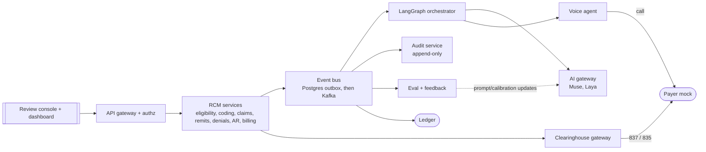

- Transactional outbox: each service writes its state change and an event row in the same Postgres transaction; a relay publishes them. Avoids lost or phantom events ([microservices.io](https://microservices.io/patterns/data/transactional-outbox.html)).
- Hackathon: the outbox table is the bus; workers poll it (or LISTEN/NOTIFY) and push to the dashboard over SSE. Later: Debezium streams the outbox to Kafka ([Debezium outbox router](https://debezium.io/documentation/reference/stable/transformations/outbox-event-router.html)).
- Long-running work (calls, appeals waiting on payers) can move to durable workflows such as [Temporal](https://docs.temporal.io) in production; LangGraph checkpoints cover the hackathon.
- Event envelope: event_id, type, claim_id, actor (agent or user), occurred_at, payload, prompt_version, trace_id.

### 3.3 Control plane and oversight console

| Console area | What it does |
| --- | --- |
| Claim timeline | Every event, AI decision, tool call, prompt version and human action for one claim, in order |
| Queues | AI-flagged (wide CCI set, guardrail hit, high-risk approval) and random QA sample, side by side |
| Approvals | Approve, edit or reject high-risk actions; comment is required on reject or edit |
| Policy and config | Risk tiers, alpha per decision type, sampling rate, model routing, kill switch per agent |
| Quality | Coverage vs target, override rate, appeal win rate, call success, cost per claim |
| Prompt and model registry | Versions in use, eval scores per version, rollback |

### 3.4 How many to build

**9-day hackathon:**

| Deployable | Contains |
| --- | --- |
| 1. RCM core (FastAPI modular monolith) | Modules: eligibility (fixture), coding (stub), claims + scrubber, remit posting, denials/appeals, AR, billing/ledger (minimal), audit, review API, outbox |
| 2. Payer mock + clearinghouse mock | Separate service so it reads as an outside party; adjudication rules, 835/277 generator, phone persona |
| 3. Voice agent worker | Real-time audio loop; separate process for latency |
| 4. React console | Dashboard, claim timeline, review queues, approvals |

**Full vision:**

Full vision: the 18 services in 3.1, split out of the monolith along module boundaries as load, team size and compliance scope require, with Kafka and durable workflows.

> [!NOTE]
> **Recommendation: 4 deployables, modular monolith**
>
> One codebase with strict module boundaries (own tables, talk via events) gives microservice seams without microservice ops. Plus LiteLLM and Laya-on-Modal as off-the-shelf pieces. Split later; the outbox and event envelope make that cheap.

|  | Modular monolith | Microservices |
| --- | --- | --- |
| Speed to build | Fast: one deploy, one DB, shared types | Slow: network calls, contracts, infra |
| Isolation | Logical (schemas, module rules) | Physical; PHI scope can be narrowed per service |
| Scaling | Whole app | Per service (voice and AI workers) |
| Fit | Hackathon and early product | Multiple teams, strict compliance boundaries |

### 3.5 Hackathon build

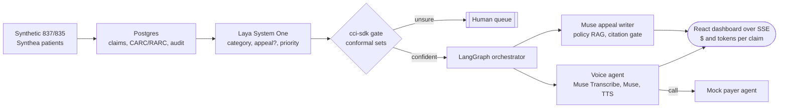

| Layer | Pick |
| --- | --- |
| Backend | Python, FastAPI, LangGraph, Postgres |
| Decisions | [Laya (Apache-2.0) on Modal or Baseten](https://huggingface.co/convaiinnovations/laya) |
| Confidence | [cci-sdk stats module; describe the enclave, don't build it](https://github.com/rahvis/cci-sdk) |
| Language and voice | Muse Spark/Wonder, Muse Voice Transcribe over websocket, TTS if the rules allow, browser call |
| Data | Synthea patients, CARC mix weighted to the Experian cause ranking |
| Eval | Conformal coverage vs target alpha, appeal citation violations, call success rate, $ per claim |

- ✗ PHI and HIPAA: synthetic data only, never Tekcel or client data. Real use needs BAAs with every vendor. Don't claim compliance.
- ✗ Call legality: the FCC ruled AI voices are "artificial" under the TCPA ([FCC 24-17](https://docs.fcc.gov/public/attachments/FCC-24-17A1.pdf)). Disclose the AI, get consent before recording (some states require all parties to agree), and only call the mock payer in the demo.
- ✗ Hackathon rules: confirm non-Meta models (Laya, TTS) are allowed, and keep Muse doing the visible work.
- ✗ Coding hallucination: catalog-constrain and verify codes.
- ✗ Laya and cci-sdk are weeks old: pin versions and keep a fallback.

### 3.6 AI architecture concepts

*Day numbers assume the Oct 26 to Nov 4 window*

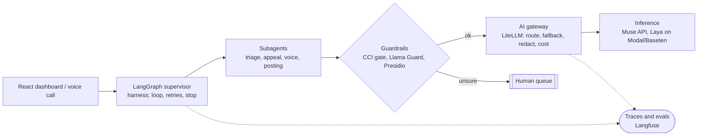

| Concept | Where in RCM | Tools | 9-day path |
| --- | --- | --- | --- |
| AI gateway | Every model call: Laya, Muse, STT/TTS | [LiteLLM](https://github.com/BerriAI/litellm) (pick: self-host, OSS, guardrail hooks), [Portkey](https://portkey.ai), [Vercel AI Gateway](https://vercel.com/docs/ai-gateway), [Cloudflare AI Gateway](https://developers.cloudflare.com/ai-gateway/) | Day 1: LiteLLM proxy in Docker with Muse primary and a fallback; tag calls with claim_id for cost per claim; add a Presidio pre-call hook to redact PHI |
| Subagents and orchestration | Supervisor routes each claim through triage, appeal writer, voice caller, poster | [LangGraph](https://langchain-ai.github.io/langgraph/), [supervisor](https://github.com/langchain-ai/langgraph-supervisor-py) vs [swarm](https://github.com/langchain-ai/langgraph-swarm-py), [MCP](https://modelcontextprotocol.io), [A2A](https://a2a-protocol.org) | Day 1 to 3: supervisor pattern (auditable, deterministic hand-offs) over swarm; expose tools (parse_835, lookup_policy, place_call) as MCP; A2A only to show the mock payer as an outside agent |
| Guardrails | Before decisions act, before letters send, on every call turn | [cci-sdk](https://github.com/rahvis/cci-sdk), [NeMo Guardrails](https://github.com/NVIDIA/NeMo-Guardrails), [Guardrails AI](https://github.com/guardrails-ai/guardrails), [Llama Guard 3](https://huggingface.co/meta-llama/Llama-Guard-3-8B), [Prompt Guard](https://huggingface.co/meta-llama/Prompt-Guard-86M), [Presidio](https://github.com/microsoft/presidio) | Day 3 to 4: CCI set size gates human review; schema validation on outputs; Prompt Guard on payer-call transcripts and uploaded PDFs; citation check on appeals. Llama Guard keeps it Meta-native |
| Harness | The loop that runs each claim to an end state | LangGraph state, checkpoints, interrupt() | Day 2: typed state per claim, max steps and budget per claim, retry with backoff on tool errors, stop on terminal states (paid, appealed, needs-human), interrupt before any send or call |
| Inference | Decisions (Laya), writing (Muse), voice (STT, LLM, TTS) | Meta Muse API, [Baseten](https://www.baseten.co), [Modal](https://modal.com), [Fireworks](https://fireworks.ai), [vLLM](https://github.com/vllm-project/vllm) | Day 2: Laya on Modal GPU with vLLM or plain HF; Muse via the gateway; for voice stream every hop and use the smallest Muse model for turn replies, measure end-to-end turn latency |
| Evals | Coding, denial triage, appeal quality, call success | [Langfuse](https://langfuse.com), [Arize Phoenix](https://github.com/Arize-ai/phoenix), [Braintrust](https://www.braintrust.dev) | Day 4 to 7: 100 to 200 synthetic denied claims with known labels; metrics: accuracy, CCI empirical coverage vs 1-alpha, average set size, ECE, citation violations, LLM-as-judge rubric for letters (spot-check by hand) |
| Token cost per claim | Dashboard metric | Gateway cost logs, prompt caching, model routing | See 3.7 |
| Sandboxes | Agent-written code (e.g. parsing an odd 835), PHI isolation | [E2B](https://e2b.dev), [Modal Sandboxes](https://modal.com/docs/guide/sandbox), [Daytona](https://www.daytona.io), Docker | Day 5: Modal Sandbox (credits already) with no network for any generated code; in production keep PHI services in a private VPC and sandboxes PHI-free |

### 3.7 Token cost per claim (estimate)

> [!WARNING]
> **Estimate, not a measurement**
>
> Assumptions: one denied claim with appeal, no voice call. Triage via Laya (typed outputs, negligible tokens). Policy RAG pulls 4 chunks of about 800 tokens. Appeal draft: about 5,000 input and 1,200 output tokens. Citation check: about 3,000 input and 300 output. Supervisor overhead: about 1,500 input and 200 output. Total about 9,500 input and 1,700 output tokens. Multiply by your model's per-token price from the gateway logs; I did not assume a price.

- Prompt caching: keep the system prompt and payer policy at the front so repeated claims for the same payer hit the cache (vLLM automatic prefix caching or the provider's cache).
- Small-model routing: the gateway sends checks and short call turns to the smallest model and only the appeal letter to the large one.
- Wastegate-style compression: have Laya make the typed decisions instead of the LLM, and compress retrieved policy to the cited clauses before writing. Show tokens before vs after on the dashboard.
- A voice call adds tokens per turn plus STT/TTS minutes; measure it rather than estimating.

## Part IV. Trust layer

### 4.1 Security

| Control | Hackathon | Production |
| --- | --- | --- |
| Authentication | OIDC login for the console; service tokens between deployables | SSO + MFA, short-lived tokens, unique user IDs (HIPAA 164.312(a), (d)) |
| Authorization | RBAC roles: biller, coder, reviewer, admin | RBAC + ABAC (facility, payer, assignment) via a policy engine such as [OPA](https://www.openpolicyagent.org) or [Cerbos](https://www.cerbos.dev); agents get their own scoped identities |
| PHI encryption | TLS everywhere; encrypted disk | Field-level encryption for identifiers, KMS keys, encrypted backups and recordings |
| Secrets | `.env` never committed; secret scanning in CI | Secret manager, rotation, no secrets in prompts or logs |
| Agent permissions | Tools allowlisted per agent | Least-privilege tool scopes; [MCP authorization spec](https://modelcontextprotocol.io/specification/2025-06-18/basic/authorization) |
| Supply chain | Pinned deps, Snyk scan | SBOM, signed images |

### 4.2 Audit trail of AI actions

| Field | Value |
| --- | --- |
| Record per action | event_id, claim_id, actor (agent name + version or user), action, inputs hash and pointer, model and provider, prompt version, retrieved chunk IDs, tool calls and results, output, Laya probabilities, CCI set and alpha, guardrail results, approver and decision, latency, tokens, cost, trace_id |
| Immutability | Append-only table (no UPDATE/DELETE grants), each row stores the hash of the previous row; periodic hash anchored to object storage with retention lock |
| Retention | HIPAA requires documentation be kept six years ([45 CFR 164.316](https://www.ecfr.gov/current/title-45/subtitle-A/subchapter-C/part-164/subpart-C/section-164.316)) |
| PHI in logs | Store pointers and hashes; PHI stays in the encrypted clinical store |
| Framework | [NIST AI RMF for govern/map/measure/manage practices](https://www.nist.gov/itl/ai-risk-management-framework) |

### 4.3 Human oversight

- Two queues: AI-flagged (wide CCI set, guardrail hit, low Laya margin, high dollar) and a random QA sample of auto-handled claims (a fixed percentage per agent per day, set in config).
- Random sampling is what measures true automated quality; flagged-only review would hide silent errors.
- Stratify samples by payer, denial category and dollar band so rare cases get seen.
- Any reviewer can open any claim timeline; show the AI's confidence only after the reviewer's first judgment to avoid anchoring.
- Track override rate per agent; if it rises, lower automation (smaller alpha, more flags) automatically.

### 4.4 Feedback loop

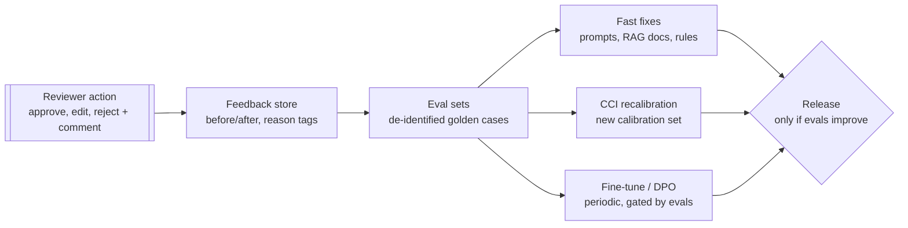

- Capture structured reasons (wrong category, wrong code, bad citation, tone) plus free-text comments.
- Edits to appeal letters become preference pairs (AI draft vs reviewer version) for DPO later; see TRL's DPO trainer: https://huggingface.co/docs/trl/dpo_trainer
- Conformal guarantees assume calibration data resembles new data; recalibrate CCI on recent reviewed claims when payer mix or policy changes.
- Hackathon: show one loop live: reviewer edits a letter, the edit becomes an eval case, rerun shows the metric.

### 4.5 Context engineering and memory

| Memory | Holds | Store |
| --- | --- | --- |
| Per-claim state | Typed LangGraph state: claim, lines, decisions, step count, budget | LangGraph Postgres checkpointer |
| Long-term payer memory | IVR maps, rep tips, denial patterns, filing limits, policy versions | Postgres + [pgvector](https://github.com/pgvector/pgvector) |
| RAG corpus | Payer policies, CMS manuals, CARC/RARC, prior winning appeals | Chunked with effective dates and IDs for citation |
| Working context | Only what the current step needs (minimum necessary) | Built per step; summaries instead of full history |

### 4.6 Approvals for high-risk actions

| Tier | Examples | Policy |
| --- | --- | --- |
| 0: read | Look up policy, check status | Automatic, logged |
| 1: reversible internal | Categorize denial, draft appeal, schedule follow-up | Automatic if CCI set is tight; random QA |
| 2: external or money | Send appeal, submit corrected claim, place payer call, post adjustment | Human approval in the console (hackathon: always) |
| 3: irreversible / patient-facing money | Write-off, refund, patient collections, sharing records | Two-person approval; reason required |

### 4.7 Safe browsing agents for payer portals

- Portal agents combine private data, untrusted page content and the ability to act, which Simon Willison calls the lethal trifecta ([post](https://simonwillison.net/2025/Jun/16/the-lethal-trifecta/)). Remove one leg wherever possible.
- Run the browser in an isolated sandbox with a domain allowlist (only the payer portal); no general web.
- Credentials injected by a vault at the form, never shown to the model; MFA handled by a human.
- Read-only by default; any submit button is a tier-2 approval.
- Record screenshots and actions to the audit trail; treat page text as data, never as instructions.
- Hackathon: a fake portal page on the payer mock, never a real payer site.

### 4.8 Invoices and accounts

- Double-entry ledger: every payment, adjustment, recoupment and write-off is a balanced entry; balances are derived, never edited.
- Money in integer cents or Decimal; idempotency keys on every posting.
- Patient statements generated from the ledger, with the 835 adjustments explained in plain language by Muse (numbers come from code, not the model).
- Payment plans and card payments through a PCI-compliant processor.
- Month-end: reconcile deposits to 835 payments; unapplied cash queue for mismatches.

### 4.9 Compliance by stage

| Control | What it requires | Hackathon demo | Production |
| --- | --- | --- | --- |
| HIPAA Privacy Rule | Limits use and disclosure of PHI by covered entities and business associates | No PHI at all; Synthea only, labeled synthetic | Policies, workforce training, patient rights handling |
| Minimum necessary | [Use or disclose only the PHI needed for the task (45 CFR 164.502(b))](https://www.ecfr.gov/current/title-45/subtitle-A/subchapter-C/part-164/subpart-E/section-164.502) | Per-agent field allowlists in prompts | Role-based views; payer calls share only claim-level identifiers |
| Security Rule technical safeguards | [45 CFR 164.312: access control, audit controls, integrity, authentication, transmission security](https://www.ecfr.gov/current/title-45/subtitle-A/subchapter-C/part-164/subpart-C/section-164.312) | Login on dashboard, TLS, audit table | SSO/MFA, unique IDs, auto-logoff, tamper-evident logs, risk analysis |
| Encryption | Addressable spec; in practice AES-256 at rest and TLS 1.2+ in transit | Postgres on encrypted disk, HTTPS | KMS-managed keys, encrypted backups, call recordings encrypted |
| BAAs | Every vendor touching PHI signs a business associate agreement | Not needed with synthetic data; say so on stage | BAAs with cloud, LLM API, voice/telephony, clearinghouse. Confirm Meta Model API, Modal, Baseten terms before any PHI |
| De-identification | [Safe Harbor removes 18 identifiers or use Expert Determination (45 CFR 164.514)](https://www.ecfr.gov/current/title-45/subtitle-A/subchapter-C/part-164/subpart-E/section-164.514) | Not needed (synthetic) | De-identify before eval sets, logs and model fine-tuning |
| Audit logs | Record who/what accessed or changed PHI | Log every agent decision and human override | Retain six years for HIPAA documentation; immutable storage |
| Breach notification | Notify individuals, HHS and sometimes media after a breach | n/a | Incident runbook |
| TCPA / FCC AI voice | [FCC 24-17: AI-generated voices are 'artificial' under the TCPA](https://docs.fcc.gov/public/attachments/FCC-24-17A1.pdf) | Call only your mock payer; agent says it's an AI | TCPA applies mainly to consumer calls; for payer B2B calls still disclose AI, and get consent before calling patients |
| Call-recording consent | Federal law is one-party consent; about a dozen states (e.g. CA, FL, IL, PA, WA) require all parties | Announce recording at call start | Always announce; store consent flag with the recording |
| X12 / CMS standards | HIPAA-mandated X12 005010 transactions (837, 835, 270/271, 276/277, 278) and code sets (ICD-10, CPT/HCPCS, CARC/RARC) | Generate valid 005010 shapes | Clearinghouse certification, payer enrollment, CMS-0057-F prior-auth APIs |
| Patient billing | No Surprises Act estimates; PCI DSS for card data | Fake ledger | Use a PCI-compliant processor; never store card numbers |

HHS guidance pages (they block automated checks but are the primary sources): hhs.gov/hipaa/for-professionals/privacy/special-topics/de-identification, hhs.gov/hipaa/for-professionals/security, and the HHS sample BAA provisions page. Encryption overview: https://www.hipaajournal.com/hipaa-encryption-requirements/

> [!WARNING]
> **Say this on stage**
>
> Synthetic data only, not HIPAA-certified, AI voice disclosed and recorded with consent, every decision auditable. Don't claim compliance you haven't built.

## Part V. Demo infrastructure: build vs reuse

> [!NOTE]
> **Recommendation: reuse the standards and data, mock the counterparties**
>
> Real negotiated payer contracts aren't obtainable for a hackathon, but public price-transparency files and CMS fee schedules give realistic rates. Use HAPI FHIR + Synthea as the EHR instead of building one, and build a small mock payer plus mock clearinghouse that speak real X12 837/835/277 shapes.

| Need | Option | Verdict |
| --- | --- | --- |
| Payer contract rates | [CMS Transparency in Coverage MRFs](https://www.cms.gov/priorities/key-initiatives/healthplan-price-transparency) | Reuse. Insurers publish in-network negotiated rates as public machine-readable files; real contracts themselves stay private |
| MRF schema | [CMSgov/price-transparency-guide](https://github.com/CMSgov/price-transparency-guide) | Reuse the schema to model a synthetic contract table |
| Pre-parsed rates | [DoltHub transparency-in-pricing](https://www.dolthub.com/repositories/dolthub/transparency-in-pricing) | Reuse a slice; MRFs are huge, don't download raw |
| Hospital prices | [DoltHub hospital-price-transparency](https://www.dolthub.com/repositories/dolthub/hospital-price-transparency) | Optional |
| Medicare rates | [CMS Physician Fee Schedule](https://www.cms.gov/medicare/payment/fee-schedules/physician) | Reuse as the 'expected payment' baseline |
| Coding edits | [CMS NCCI edits](https://www.cms.gov/medicare/coding-billing/national-correct-coding-initiative-ncci-edits) | Reuse in the scrubber |
| EHR | [HAPI FHIR public server](https://hapi.fhir.org) | Fine for quick tests, but it's public: synthetic data only |
| EHR (self-host) | [hapi-fhir-jpaserver-starter (Docker)](https://github.com/hapifhir/hapi-fhir-jpaserver-starter) | Recommended: local, no PHI risk |
| Full EHR UI | [OpenEMR](https://github.com/openemr/openemr) | Skip unless you need a clinic UI; heavy for 9 days |
| Vendor EHR sandboxes | [Epic on FHIR](https://fhir.epic.com) / [Oracle Health (Cerner)](https://fhir.cerner.com) | Optional credibility; registration needed, read-mostly |
| Synthetic patients | [Synthea](https://github.com/synthetichealth/synthea) | Reuse; exports FHIR and CSV |
| Synthetic claims | [CMS synthetic Medicare claims](https://data.cms.gov/collection/synthetic-medicare-enrollment-fee-for-service-claims-and-prescription-drug-event) | Reuse for realistic claim lines |
| Real clinical data | [MIMIC-IV](https://physionet.org/content/mimiciv/) | Skip: credentialed access, CITI training and a DUA; can't be sent to hosted LLM APIs casually |
| Medicare claims API | [CMS Blue Button 2.0 sandbox](https://bluebutton.cms.gov/api-documentation/) | Optional: synthetic beneficiaries, FHIR ExplanationOfBenefit |
| Prior auth | [Da Vinci prior-auth RI](https://github.com/HL7-DaVinci/prior-auth) / [PAS IG](https://build.fhir.org/ig/HL7/davinci-pas/) | Reuse if you add prior auth; ties to CMS-0057-F |
| Eligibility / claims API | [Stedi healthcare APIs](https://www.stedi.com/docs/healthcare) | Best real-API option; test mode for mock requests (check plan) |
| Availity / Optum | [Availity developer](https://developer.availity.com) / [Optum developer (Change Healthcare)](https://developer.optum.com) | Sandboxes need org onboarding; likely too slow for the hackathon |
| Office Ally | officeally.com (site didn't respond to my check) | Provider clearinghouse; no quick public sandbox found |
| X12 samples | [X12 examples](https://x12.org/examples) | Reuse as fixtures for 837/835/270/271/276/277 |
| Denial codes | [CARC](https://x12.org/codes/claim-adjustment-reason-codes) / [RARC](https://x12.org/codes/remittance-advice-remark-codes) | Reuse as the label space for Laya |
| Appeal process | [Medicare FFS appeals](https://www.cms.gov/medicare/appeals-grievances/fee-for-service) | Reuse levels and deadlines in the appeal RAG |

- Payer policy PDFs and denial letters: no clean public dataset found. Pull a few public medical policies from payer websites and write synthetic denial letters keyed to CARC/RARC.
- Build: mock payer (adjudication rules, 835 generator, voice persona), mock clearinghouse (999/277CA), thin EHR facade over HAPI FHIR, AR and ledger tables in Postgres.
- Don't build: a full EHR UI, a real clearinghouse connection, or real payer enrollment.

## Part VI. Market and research (moved)

Companies, best products (why they won, gaps as opportunities), state of the art, papers and the repo teardown now live here:

- [RCM Landscape: Who Won & Why](https://cursor.com/canvas/store-2f9b6419-214d-4ae3-ba39-6b55775ac5bc/aecd7038-617d-4b7d-b2a9-2723200ba3e1) (cursor.com)

## Part VII. Building it

### 7.1 Elite Builder Playbook (primary doc)

How elite developers build with AI, plus the review checklists, verification loops, prompts and rules files, now live on their own page. It's the primary doc for all development.

- [Elite Builder Playbook (primary doc)](https://cursor.com/canvas/store-2f9b6419-214d-4ae3-ba39-6b55775ac5bc/b7d4e5e1-54f1-46ce-b2af-97c24289a648) (cursor.com)

### 7.2 REA: Reverse Engineer Anything

> [!NOTE]
> **Correction: the earlier 'REA' pick was a mismatch**
>
> REA is morluto/rea (MIT), a local MCP server plus a reverse-engineer-anything skill for coding agents. The RCM repo previously listed here (hamzaabbasai/ai-revenue-cycle-agent) was a guess; its teardown is kept below as a reference RCM architecture.

| Field | Value |
| --- | --- |
| Repo | [github.com/morluto/rea](https://github.com/morluto/rea) |
| Site | [reverseengineeringanything.com](https://reverseengineeringanything.com) |
| Install | `npx rea-agents setup` (pick Cursor, Claude Code, Codex, Gemini CLI, Grok Build...). Skill only: `npx skills add morluto/rea --skill reverse-engineer-anything` |
| What it inspects | Native binaries (via Hopper, Ghidra or IDA), JavaScript/Electron apps, .NET assemblies, packages, firmware and websites. JS/Electron needs no native engine. |
| How it works | Setup registers the `rea` MCP server and installs a workflow skill. The agent calls REA tools to decompile or trace a feature, then answers with evidence (source ranges, call paths, addresses) and states what stays unresolved. Analysis runs locally. |
| Requirements | Node 22.19+, 24.11+ or 26+; on Linux a procps `ps` |

1. **Pick one competitor feature you can legally inspect** — A public web app UI, a demo site, or an Electron desktop client you have a license for, e.g. a denial worklist or an appeal-letter generator.
2. **Brief the agent narrowly** — 'Use REA on <site or app>. Trace how the denial worklist is prioritized and how the appeal draft is assembled. Show entry point, data transforms, and API calls. Cite locations. Do not run the target.'
3. **Ask for a behavior spec, not code** — Inputs, outputs, states and edge cases (e.g. CARC to category mapping, appeal templates, call-note schema).
4. **Rebuild your own version** — Implement the spec in your stack with Laya + CCI + Muse, then show where yours goes further (calibrated abstention, voice loop).

- ✗ Respect terms of service and licenses: many SaaS terms forbid reverse engineering. Stick to public front-end behavior, open-source tools, and your own apps.
- ✗ Never point it at systems holding real PHI or logged-in customer portals.
- ✗ Treat decompiler inferences as hypotheses; REA's own guide recommends a behavior spec before building.

The open-source RCM reference repos and the competitor-repo teardown moved to the Landscape page, section 6.

- [RCM Landscape → 6. Open-source RCM repos and a teardown](https://cursor.com/canvas/store-2f9b6419-214d-4ae3-ba39-6b55775ac5bc/aecd7038-617d-4b7d-b2a9-2723200ba3e1) (cursor.com)

## Part VIII. How it's done at a company

*Unless a source is linked, this part describes general industry practice, not a specific company's process.*

### 8.1 Team roles

| Role | Owns in this product | Hackathon stand-in |
| --- | --- | --- |
| Product manager | Problem, KPIs, roadmap, customer discovery with RCM leaders | Sai: the one-page spec and demo story |
| Engineering (backend, frontend, ML/AI) | Services, console, agents, evals | Sai + coding agents (per the Playbook) |
| RCM operations / SMEs | Workflows, denial categories, appeal templates, label quality | CARC/RARC docs and public payer policies |
| Compliance / privacy officer | HIPAA program, BAAs, risk analysis, policies | The 'say this on stage' disclaimer and synthetic data |
| Security | Threat models, access reviews, pen tests, vendor reviews | Snyk scan, secrets hygiene, prompt-injection tests |
| QA | Test strategy, regression suites, UAT with ops | Golden sets and the e2e smoke test |
| SRE / platform | Environments, CI/CD, observability, on-call, SLOs | Docker Compose, one CI pipeline, Langfuse traces |

### 8.2 SDLC, environments and change management

1. **Design doc / RFC** — Problem, goals and non-goals, options, chosen design, risks, PHI data flow, rollout plan. Reviewed by eng, security and compliance before build.
2. **ADRs** — One short record per significant decision (context, decision, consequences), kept in the repo; format from [Michael Nygard's 2011 post](https://cognitect.com/blog/2011/11/15/documenting-architecture-decisions), see also [adr.github.io](https://adr.github.io). Write ADRs for: modular monolith, outbox, LiteLLM, supervisor pattern, CCI gating.
3. **Environments** — dev (synthetic data), staging (production-like, synthetic or de-identified data), prod (PHI, restricted access). Promote the same build artifact through each.
4. **CI/CD** — PR checks (lint, types, tests, evals, security scans), merge to main, deploy to staging automatically, gated deploy to prod with feature flags and rollback.
5. **Change management** — Prod changes are tracked and approved (ticket + PR + deploy record); prompt and model changes go through the same path because they change behavior. SOC 2 auditors typically ask for this evidence.
6. **Code review norms** — At least one approving reviewer; CODEOWNERS for sensitive areas (billing, auth, PHI); small PRs; author self-reviews first. AI-written code follows the Playbook's review gates.

[DORA](https://dora.dev) research is the common reference for delivery metrics: deployment frequency, lead time for changes, change failure rate and time to restore.

### 8.3 Operations: on-call, incidents, SLOs

| Practice | In this product |
| --- | --- |
| [SLOs (Google SRE book)](https://sre.google/sre-book/service-level-objectives/) | Examples to set: eligibility API p95 latency, claim submission success rate, 835 posting completed within N hours of receipt, voice call connect rate |
| On-call | Rotation with runbooks per service: clearinghouse outage, payer mock down, model provider outage (fail to human queue) |
| Incident response | Severity levels, incident commander, comms, and a separate path when PHI may be involved (privacy officer, HIPAA breach assessment) |
| [Blameless postmortems](https://sre.google/sre-book/postmortem-culture/) | Timeline, root cause, action items; AI incidents (bad appeal sent, wrong code) included |
| AI-specific monitoring | CCI coverage, override rate, guardrail hits, cost per claim, drift by payer |

### 8.4 Security and compliance programs

| Program | What it is | What a startup does |
| --- | --- | --- |
| HIPAA Security Rule | [Administrative safeguards incl. risk analysis, workforce training, contingency plans (45 CFR 164.308)](https://www.ecfr.gov/current/title-45/subtitle-A/subchapter-C/part-164/subpart-C/section-164.308) | Annual risk analysis, policies, training, a named security officer |
| SOC 2 | [AICPA attestation on security, availability, confidentiality, etc.](https://www.aicpa-cima.com/topic/audit-assurance/audit-and-assurance-greater-than-soc-2) | Type I then Type II report; buyers often ask for it in security reviews |
| HITRUST | [Certifiable healthcare-focused control framework](https://hitrustalliance.net) | Often requested by larger health systems and payers |
| Vendor management | BAAs and security questionnaires for every sub-processor (cloud, LLM API, telephony, clearinghouse) | Keep a sub-processor list; confirm each AI vendor offers a BAA and no-training terms |
| Data governance | Data classification, retention, access reviews, de-identification for analytics and training | PHI only in prod; de-identified copies for evals; documented lineage |
| AI governance | [NIST AI RMF](https://www.nist.gov/itl/ai-risk-management-framework) | Model inventory, intended use, eval results, human oversight design, incident process |

### 8.5 Rolling out AI in an enterprise

*General practice*

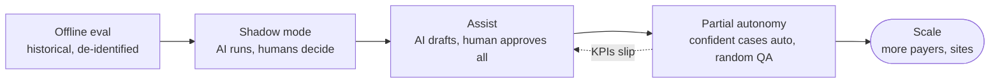

| KPI | Why it matters | Benchmark (source) |
| --- | --- | --- |
| Initial denial rate | Upstream quality | [11.6% average, Kodiak 2025](https://www.healthleadersmedia.com/revenue-cycle/cash-flow-improves-despite-484-billion-revenue-leakage-2025) |
| Days in AR | Cash speed | [52.6 median, Kodiak 2025](https://www.healthleadersmedia.com/revenue-cycle/cash-flow-improves-despite-484-billion-revenue-leakage-2025) |
| Clean claim rate | First-pass acceptance | [Target ≥98%, HFMA chapter deck](https://www.hfma.org/wp-content/uploads/2025/10/fromregistrationtoreimbursement-fallconf2025-greaterheartland.pdf) |
| Appeal overturn rate | Appeal quality | [Target >60%, HFMA chapter deck](https://www.hfma.org/wp-content/uploads/2025/10/fromregistrationtoreimbursement-fallconf2025-greaterheartland.pdf) |
| Cost to collect, staff hours per claim | ROI | Measure at baseline before the pilot |
| AI override rate, CCI coverage | Trust and safety | Set targets with ops during shadow mode |

Pilot design (general practice): one site, one or two payers, a baseline period, a control group or before/after comparison, and an exit criterion agreed with the RCM director before go-live.

### 8.6 Prioritizing and selling it (moved)

Buyers, ROI worked example, procurement and pricing now live on the Idea & Products page, section 5.

- [Revora: Idea & Products → 5. Buyers, ROI and procurement](https://cursor.com/canvas/store-2f9b6419-214d-4ae3-ba39-6b55775ac5bc/80ce4a4b-2037-4660-a261-d5602478fcf4) (cursor.com)

## Part IX. Explaining it in interviews

### 9.1 System design talking points

1. Requirements first: volume (claims per day), latency (voice is real-time, appeals are batch), compliance (PHI, audit), and correctness (money).
2. Deterministic core, AI at the edges: EDI build, posting and ledger are code; AI does classification, drafting and conversations.
3. Calibrated abstention: CCI conformal sets decide what goes to humans, with a coverage target instead of a raw confidence threshold.
4. Event-driven with an outbox: reliable events, a complete audit trail, and a clean path from monolith to services.
5. Human oversight by design: random QA plus AI flags, approval tiers, and a feedback loop into evals and recalibration.
6. Cost control: gateway routing, caching, small typed models for decisions, cost per claim on the dashboard.

### 9.2 Tradeoffs to articulate

| Decision | Chose | Tradeoff |
| --- | --- | --- |
| Monolith vs microservices | Modular monolith | Speed and simplicity now vs per-service scaling and PHI isolation later |
| Supervisor vs swarm | Supervisor | Auditability and predictability vs flexibility |
| LLM picks codes vs constrained | Catalog + Laya + verifier | Lower recall on odd cases vs no fabricated codes |
| Auto vs human approval | Tiered | Throughput vs risk; tiers move as evidence builds |
| Hosted models vs self-hosted | Hosted Muse + self-hosted Laya | Speed and quality vs BAA, data control and cost |
| Kafka now vs later | Postgres outbox now | Fewer moving parts vs throughput ceiling |

### 9.3 STAR story templates from this build

| Theme | Situation / Task | Action | Result (fill with real numbers) |
| --- | --- | --- | --- |
| Reliability of AI | LLMs fabricate medical codes (NEJM AI result) | Constrained to a catalog, added verifier and conformal gating | Coverage X% at alpha Y on the golden set; zero invented codes |
| Safety and compliance | Voice agent calling payers raises TCPA and PHI concerns | AI disclosure, recording consent, minimum-necessary script, mock payer only | Demo passed a self-run compliance checklist |
| Cost | Token spend per claim too high | Gateway routing, caching, Wastegate-style compression | Tokens per claim from A to B (measured) |
| Speed under constraints | Nine days, one builder | Modular monolith, agents with strict review gates | Shipped N services, M tests, E2E demo |
| Feedback loop | Reviewers fix appeals but the AI doesn't learn | Captured edits as eval cases and preference pairs, recalibrated CCI | Metric moved from P to Q after one loop |

STAR format reference: https://www.techinterviewhandbook.org/behavioral-interview/ . Only quote numbers you actually measured.

### 9.4 Likely questions and answer outlines

| Question | Answer outline |
| --- | --- |
| Walk me through the architecture. | Pipeline stages, deterministic core vs AI parts, event bus, oversight console, audit (Part III diagram) |
| How do you know the AI is right? | Golden sets, CCI coverage, random QA, override rate, citation checks; humans on anything external |
| How do you handle PHI with LLMs? | BAAs, minimum necessary, redaction at the gateway, no training on PHI without agreements, audit logs |
| What happens when the model provider is down? | Gateway fallback, queue work, route to humans, never auto-approve on fallback |
| How would you scale to 10x claims? | Split hot modules (posting, AI workers), Kafka, horizontal workers, caching, batch where latency allows |
| How would you roll this out at a hospital? | Offline eval, shadow mode, assist, partial autonomy, KPIs agreed with the RCM director (8.5) |
| What would you do differently? | Honest gaps: real EDI certification, payer integrations, larger labeled data, formal security review |
| How did you use AI to build it? | Playbook flow: plan, tests first, small diffs, second-model review, CI gates; you own every line |
