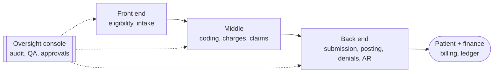

> Verbatim snapshot of the "Revora: Idea & Products" research page as of Oct 26, 2026. Not maintained. See [README](README.md) for what was changed for the public repo.

# Revora: Idea & Products

*Revora: AI agents that get you paid. What Revora, Sai's AI-powered RCM suite, is, who each product serves, what the AI does in it, what ships in the 9-day hackathon versus the full vision, and how a company would buy it.*

> [!NOTE]
> **Primary doc: Elite Builder Playbook**
>
> Build everything following the Elite Builder Playbook: https://cursor.com/canvas/store-2f9b6419-214d-4ae3-ba39-6b55775ac5bc/b7d4e5e1-54f1-46ce-b2af-97c24289a648 . Architecture and compliance: RCM Hackathon Build Guide: https://cursor.com/canvas/store-2f9b6419-214d-4ae3-ba39-6b55775ac5bc/0d09f3df-55fe-44ed-b292-b147cf442cb6 . Market: RCM Landscape: Who Won and Why (linked at the bottom).

**Contents**

- [1. The idea](#idea)
- [2. Products and services](#prod)
- [3. Hackathon cut vs full vision](#cut)
- [4. Oversight, feedback and approvals (product view)](#ovs)
- [5. Buyers, ROI and procurement](#sell)
- [6. Related pages](#rel)

## 1. The idea

An AI-powered suite that covers the whole revenue cycle, from scheduling to the ledger. Every AI action is secured and recorded. Humans can open any claim at random, and the AI flags the claims it isn't sure about. Reviewer corrections feed back into the AI so it improves.

- Why now: average initial denial rate is 11.6% and median days in AR 52.6 ([Kodiak 2025](https://www.healthleadersmedia.com/revenue-cycle/cash-flow-improves-despite-484-billion-revenue-leakage-2025)); reworking a denial costs about $103 ([HFMA deck](https://www.hfma.org/wp-content/uploads/2025/10/fromregistrationtoreimbursement-fallconf2025-greaterheartland.pdf)); 90% of denials still get human review ([Experian 2025](https://www.experian.com/content/dam/noindex/na/us/healthcare/state-of-claims-2025.pdf)).
- The wedge: calibrated abstention (CCI decides what goes to a human) plus a voice agent whose call outcome updates the claim live.

## 2. Products and services

| Product | User | Value | AI parts | Hackathon |
| --- | --- | --- | --- | --- |
| Eligibility & Benefits | Front desk, scheduling | Know coverage, copay and auth needs before the visit | Laya decides if a call or auth is needed; voice agent fills benefit gaps | Fixture or Stedi test mode |
| Intake & Registration | Patients, front desk | Clean demographics and insurance on the first try (registration errors cause 32% of denials per Experian 2025) | Chat/voice intake, card extraction, field validation | Seeded via Synthea |
| Coding Assist | Coders, CDI | Faster coding without invented codes | Catalog retrieval, Laya choice, CCI gate to human coder | Stub |
| Charge Capture | Billing | Fewer missed charges | Missed-charge detection | Not in demo |
| Claim Builder & Scrubber | Billers | Clean claims first pass | Denial-risk score and fix suggestions on top of NCCI/MUE rules | In core |
| Clearinghouse Gateway | System | Reliable 837 out, 999/277CA/835 in | Rejection triage | Mock |
| Remit Posting | Payment posters | Auto-posting and underpayment detection | Root-cause category for denied lines | In core |
| Denials & Appeals | Denials team | Triage and grounded appeal letters in minutes | Laya + CCI + Muse writer + citation gate | Core of the demo |
| Payer Voice Agent | AR callers | No more hold time on status and benefit calls | STT, LLM turns, TTS, IVR navigation; writes structured outcome | Calls the mock payer |
| AR Follow-up | AR team | Work the right claims first | Prioritizer, 276/277 interpreter | In core |
| Patient Billing | Patients | Bills people understand, payment plans | Plain-language explanations (numbers from code) | Minimal |
| Accounts & Ledger | Finance | Correct balances, clean month-end | None: deterministic double-entry | Minimal |
| Review & Oversight Console | Supervisors, QA, compliance | See and control every AI action | Reviewer-assist summaries | Own app |
| Audit Service | Compliance, auditors | Prove who/what did what and why | None | In core |
| AI Gateway | Platform | Cost control, fallbacks, PHI redaction | Routing and guardrail hooks | LiteLLM off the shelf |
| Eval & Feedback | AI team | AI gets measurably better from reviewer input | LLM-as-judge, calibration | Golden set + one live loop |
| Identity & Access | Admins | Right people see the right claims | None | Simple login |
| Payer Mock (demo only) | Demo | A realistic counterparty to call and bill | Muse plays the payer rep | Own app |

Engineering detail for each (data owned, APIs, events) is in Build Guide 3.1.

## 3. Hackathon cut vs full vision

**9-day hackathon: 4 apps:**

| App | Products inside | What the judges see |
| --- | --- | --- |
| 1. RCM core (modular monolith) | Claims and scrubber, posting, denials and appeals, AR, minimal billing/ledger, audit, review API | A denied claim triaged, gated and appealed with citations |
| 2. Payer + clearinghouse mock | Adjudication, 835/277, phone persona | A realistic insurer on the other end |
| 3. Voice agent | Payer calls | A live call whose outcome updates the claim |
| 4. Review console | Dashboard, timelines, queues, approvals | Human oversight, audit trail, cost per claim |

**Full vision: 18 services:**

All 18 products in section 2 as separately deployable services, split from the monolith along module boundaries when scale, teams or compliance scope require it.

## 4. Oversight, feedback and approvals (product view)

| Capability | What the user experiences |
| --- | --- |
| Claim timeline | Open any claim and see every AI and human action, model, prompt version and sources, in order |
| Two review queues | AI-flagged claims (unsure, guardrail hit, high dollar) and a random sample of auto-handled ones |
| Approvals | External or money actions (send appeal, call, adjust) wait for a click; write-offs and refunds need two people |
| Feedback | Edit or reject with a reason; the edit becomes a test case and the AI's metrics update |
| Controls | Supervisors set sampling rate, confidence level and a kill switch per agent |

## 5. Buyers, ROI and procurement

*General practice; the ROI example is an illustrative estimate with stated inputs, not a measured result.*

| Topic | How it typically works |
| --- | --- |
| Buyers | VP/Director of Revenue Cycle and the CFO sign; CIO/IT, security and compliance must approve; RCM managers and billers are daily users |
| Prioritization | Rank use cases by dollars at stake x volume x feasibility; denials and AR follow-up usually lead because the money is visible |
| Procurement | Security questionnaire, BAA, SOC 2/HITRUST evidence, integration plan (EHR, clearinghouse), legal review, pilot SOW, then enterprise contract |
| Pricing models | Per claim, per transaction, percentage of recovered dollars, or platform subscription |
| Pilot | One site, one or two payers, baseline period, agreed exit criteria (denial rate, days in AR, clean claim rate, overturn rate) |
| Competition | EHR modules, platforms and point-solution startups (see the Landscape page) |

> [!WARNING]
> **ROI worked example (estimate)**
>
> Inputs: a group that works 1,000 denials a month at the HFMA-cited $103 rework cost spends about $103,000 a month on rework. If AI handles half of them at a quarter of the cost, savings are about $38,600 a month before software cost, plus any lift in overturn rate. Replace every input with the customer's own numbers.

## 6. Related pages

- [0. Meta Hackathon Brief (read first)](https://cursor.com/canvas/store-2f9b6419-214d-4ae3-ba39-6b55775ac5bc/3ae4ac4c-0964-4471-83cb-753724da2f24) (cursor.com)
- [Elite Builder Playbook (primary doc)](https://cursor.com/canvas/store-2f9b6419-214d-4ae3-ba39-6b55775ac5bc/b7d4e5e1-54f1-46ce-b2af-97c24289a648) (cursor.com)
- [RCM Hackathon Build Guide (architecture, trust, compliance)](https://cursor.com/canvas/store-2f9b6419-214d-4ae3-ba39-6b55775ac5bc/0d09f3df-55fe-44ed-b292-b147cf442cb6) (cursor.com)
- [RCM Landscape: Who Won & Why](https://cursor.com/canvas/store-2f9b6419-214d-4ae3-ba39-6b55775ac5bc/aecd7038-617d-4b7d-b2a9-2723200ba3e1) (cursor.com)
