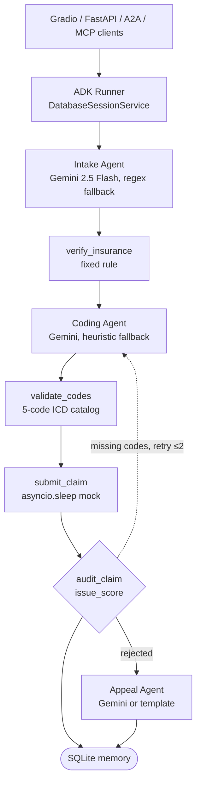

> Verbatim snapshot of the "RCM Landscape: Who Won & Why" research page as of Oct 26, 2026. Not maintained. See [README](README.md) for what was changed for the public repo.

# RCM Landscape: Who Won & Why

*Revora: AI agents that get you paid. The RCM market Revora enters: who the leaders are, why they succeeded, what they did differently, and where their gaps leave room. Facts link to sources; 'why they won' and 'gaps' are my analysis.*

> [!NOTE]
> **Primary doc: Elite Builder Playbook**
>
> Development follows the Elite Builder Playbook: https://cursor.com/canvas/store-2f9b6419-214d-4ae3-ba39-6b55775ac5bc/b7d4e5e1-54f1-46ce-b2af-97c24289a648 . Product vision: Revora: Idea & Products: https://cursor.com/canvas/store-2f9b6419-214d-4ae3-ba39-6b55775ac5bc/80ce4a4b-2037-4660-a261-d5602478fcf4 . Architecture: RCM Hackathon Build Guide: https://cursor.com/canvas/store-2f9b6419-214d-4ae3-ba39-6b55775ac5bc/0d09f3df-55fe-44ed-b292-b147cf442cb6

**Contents**

- [1. Who won and why (deep dives)](#win)
- [2. Startup map and funding](#co)
- [3. Healthcare voice agents](#voice)
- [4. State of the art techniques](#sota)
- [5. Papers and studies](#pap)
- [6. Open-source RCM repos and a teardown](#repo)
- [7. Related pages](#rel)

## 1. Who won and why (deep dives)

*Columns 3 to 5 are my analysis of public positioning, not rankings or awards. KLAS (klasresearch.com) publishes rated comparisons.*

| Product | What it is | Why it succeeded (analysis) | What it did differently (analysis) | Gaps = opportunities for Sai (analysis) |
| --- | --- | --- | --- | --- |
| [Epic Resolute](https://www.epic.com/software/revenue-cycle/) | RCM inside the Epic EHR | Comes bundled with the EHR many health systems already run, so no extra integration | One record from registration to billing; clinical and financial data never leave the system | Its strength is breadth; a focused AI denial and voice layer that plugs in via FHIR and sits beside it, rather than replacing it, is a fit |
| [Waystar](https://www.waystar.com) | Cloud RCM platform plus clearinghouse; public company (NASDAQ: WAY) | Owns the claim pipe from eligibility to remits across many payers | Network data across payers feeds its predictive features | Calibrated human handoff and live payer calls are not what it leads with; show those as the differentiator |
| [Availity](https://www.availity.com) | Provider-payer network and portal | Many payers use it as their front door for providers, which builds network effects | Built the connection layer rather than an app | Portals still require humans clicking; a safe portal or voice agent that turns portal work into structured data |
| [AKASA](https://akasa.com) | Autonomous inpatient coding; earlier broader RCM automation | Narrowed to a high-value task where accuracy is measurable | Per-health-system customization and keeping coders in control (per its site) | Coding is crowded; Sai's angle is the denial and appeal loop downstream |
| [Infinitus](https://www.infinitus.ai) | Voice agents for payer calls | Picked the most painful manual task (calls) and captured structured data from each | Guardrailed calls plus a payer knowledge graph from millions of calls (per its funding release) | Focus is benefits and prior auth for specialty pharma and providers; denial appeals end to end with a written appeal plus call is open space |
| [Cedar](https://www.cedar.com) | Patient billing and payments | Treated the patient bill as a consumer product | Design and engagement over back-office features | Patient explanations tied to the exact 835 adjustment and appeal status |
| [Abridge](https://www.abridge.com) | Ambient clinical documentation | Fixes data at the source, which helps everything downstream | Captures the conversation instead of asking clinicians to type | Linking documentation gaps to specific denials and appeals |
| [SmarterDx](https://www.smarterdx.com) | Pre-bill clinical review | Catches revenue and quality issues before billing, when it's cheapest | Reviews the full chart with clinical AI | Post-denial work and payer communication |
| [Candid Health](https://www.candidhealth.com) | API-first claims, posting and denials | Built for digital-health companies with engineering teams | Rules engine and APIs instead of a services-heavy model | Calibrated AI decisions and voice on top of an API-first core |
| [Adonis](https://www.adonis.io) | Denials, AR, orchestration | Focus on the back end where money is visibly lost | Monitoring plus agents that drive claims to resolution | Show audited, calibrated autonomy and reviewer feedback loops as the trust story |

## 2. Startup map and funding

*'Not verified' = no primary funding source found*

| Company | Product and RCM steps | AI approach | Funding |
| --- | --- | --- | --- |
| [AKASA](https://akasa.com) | Hospital rev cycle: coding, auth, claims | GenAI trained on rev-cycle data | $250M total; $125M Series C 2022 (secondary source) |
| [Infinitus](https://www.infinitus.ai) | Voice agents for payer calls | Guardrailed voice agents plus a payer knowledge graph from 4M+ calls | [$51.5M Series C, $102.9M total](https://www.prnewswire.com/news-releases/infinitus-systems-raises-51-5-million-series-c-funding-on-the-strength-of-ai-guardrails-302283847.html) |
| [Thoughtful AI](https://www.thoughtful.ai) | Agents for eligibility, claims and posting | Agentic automation | [New Mountain growth round, undisclosed](https://www.businesswire.com/news/home/20250409471014/en/Thoughtful.ai-Announces-Growth-Investment-from-New-Mountain-Capital) |
| [SmarterDx / Smarter Technologies](https://www.smarterdx.com) | Pre-bill review, CDI | Clinical LLMs over the full chart | [$50M Series B](https://www.smarterdx.com/newsroom/smarterdx-raises-50m-to-bolster-hospital-revenue-integrity-and-quality-with-its-clinical-ai-solution) |
| [CodaMetrix](https://www.codametrix.com) | Autonomous coding | ML and NLP on notes | [≈$106M total per SEC filings](https://www.dealdata.net/company-profile/0001959785/) |
| [Fathom](https://www.fathomhealth.com) | Autonomous coding | Deep learning and NLP | Not verified |
| [Cohere Health](https://www.coherehealth.com) | Payer-side prior auth | Clinical intelligence and auto-approval | Not verified |
| [Anterior](https://anterior.com) | Health-plan prior auth and payment integrity | LLMs plus forward-deployed clinicians | [$40M (Feb 2026), $64M total](https://anterior.com/insights/announcements/anterior-raises-40m-series/) |
| [Adonis](https://www.adonis.io) | Denials, AR, orchestration | Monitoring plus agents | [$40M Series C (Mar 2026), $95M+ total](https://www.prnewswire.com/news-releases/adonis-raises-40m-series-c-to-equip-healthcare-providers-with-aidriven-revenue-cycle-operations-302722199.html) |
| [Candid Health](https://www.candidhealth.com) | API-first claims, posting and denials | Rules engine plus automation | [$52.5M Series C, $99.5M total](https://candidhealth.com/blog/candid-health-raises-usd52-5-million-series-c) |
| [Waystar](https://www.waystar.com) | End-to-end platform and clearinghouse | Predictive and GenAI features | Public (NASDAQ: WAY) |
| [Notable](https://www.notablehealth.com) | Front end: intake, registration, auth | EHR workflow agents | Not verified |
| [Magical](https://www.getmagical.com) | Admin and RCM task agents | Browser agents | Not verified |

Pattern (analysis): each startup owns one slice. Nobody's public positioning I read leads with a statistical guarantee on when a claim goes to a human, or with a written appeal plus a live payer call in one loop. That's Sai's wedge.

## 3. Healthcare voice agents

*One-line descriptions from company sites, not independently verified*

| Company | What they built |
| --- | --- |
| [Infinitus](https://www.infinitus.ai) | Voice agents for payer calls (benefits, prior auth status) |
| [Hippocratic AI](https://www.hippocraticai.com) | Healthcare voice agents for patient-facing tasks |
| [Assort Health](https://www.assorthealth.com) | Voice agents for patient phone calls and scheduling |
| [Sohar Health (YC)](https://www.ycombinator.com/companies/sohar-health) | Insurance eligibility and verification APIs |
| [Commure](https://www.commure.com) | RCM, ambient documentation and agents |

## 4. State of the art techniques

| Technique | Use here | Source |
| --- | --- | --- |
| Agentic RAG | The appeal agent decides what to retrieve next (policy, chart, prior appeals) | [Agentic RAG survey (arXiv 2501.09136)](https://arxiv.org/abs/2501.09136) |
| GraphRAG | Payer, policy, CPT, CARC graph for 'which policy clause applies' | [Microsoft GraphRAG](https://microsoft.github.io/graphrag/) |
| Structured outputs | Every agent returns JSON schemas; no free-text codes | [OpenAI structured outputs](https://platform.openai.com/docs/guides/structured-outputs), [Outlines](https://github.com/dottxt-ai/outlines) |
| Reasoning models | Use for the appeal argument only; too slow for voice turns | Muse Wonder if the rules allow |
| Voice agent stacks | Payer calls with STT, LLM and TTS, interruptions, IVR navigation | [Pipecat](https://github.com/pipecat-ai/pipecat), [LiveKit Agents](https://github.com/livekit/agents), [Vapi](https://vapi.ai), [Retell](https://www.retellai.com) |
| Computer-use agents | Payer portals with no API (claim status, attachments) | [Anthropic computer use](https://docs.anthropic.com/en/docs/agents-and-tools/computer-use), [browser-use](https://github.com/browser-use/browser-use) |

## 5. Papers and studies

| Paper | Takeaway |
| --- | --- |
| [LLMs Are Poor Medical Coders (NEJM AI 2024)](https://ai.nejm.org/doi/full/10.1056/AIdbp2300040) | GPT-4 hit 33.9% exact on ICD-10-CM and 49.8% on CPT, and Llama2-70b was under 5%. Never let an LLM pick codes freely. |
| [Code Like Humans (arXiv 2509.05378)](https://arxiv.org/html/2509.05378v3) | Multi-agent coding that follows the official guidelines and covers 70K+ ICD-10 codes. Best on rare codes; classifiers still win on common ones. |
| [Reliable Clinical Coding: Verification (arXiv 2510.07629)](https://arxiv.org/html/2510.07629v1) | Many misses are hierarchical near-misses, and a verification step fixes a lot of them. |
| [Deep Claim (arXiv 2007.06229)](https://doi.org/10.48550/arxiv.2007.06229) | Predicts denial probability, reason codes and payment timing from 2.9M claims, with +22% recall at 95% precision. |
| [ML denial prediction (Frontiers 2026)](https://doi.org/10.3389/frhs.2026.1927175) | PR-AUC 0.777 on 679K lines, but Top-3 reason-code accuracy is only 0.498. An argument for conformal sets over a single guess. |
| [AGVF appeal generation (arXiv 2609.27844)](https://arxiv.org/abs/2609.27844) | Five agent roles plus a citation-grounding gate on 1,000 synthetic appeals. |
| [Experian State of Claims 2025](https://www.experian.com/content/dam/noindex/na/us/healthcare/state-of-claims-2025.pdf) | Survey of 250 providers ranking denial causes. 67% think AI helps, but adoption is low. |
| [AKASA / HFMA Pulse 2024](https://akasa.com/press/genai-impact-medical-coding-operations) | 90% of 284 rev-cycle leaders expect GenAI to change coding; 65% expect a substantial impact. |
| [CAQH Index 2024](https://www.caqh.org/hubfs/Index/2024%20Index%20Report/CAQH%5FIndexReport%5F2024%5FFINAL.pdf) | $20B of $90B in admin spend is automatable, with eligibility the biggest piece. |
| [Kodiak benchmarks 2025](https://www.healthleadersmedia.com/revenue-cycle/cash-flow-improves-despite-484-billion-revenue-leakage-2025) | Denial, AR and leakage benchmarks. |

## 6. Open-source RCM repos and a teardown

- [hamzaabbasai/ai-revenue-cycle-agent (teardown below)](https://github.com/hamzaabbasai/ai-revenue-cycle-agent) (github.com)
- [ericg1212/agentic-rcm-pipeline: Kafka, NCCI gate, LLM tool use](https://github.com/ericg1212/agentic-rcm-pipeline) (github.com)
- [dschmitz05/denial_navigator: 835/837 parsing](https://github.com/dschmitz05/denial_navigator) (github.com)
- [Fadil369/HealthLinc: FHIR/HL7 RCM plus EHR](https://github.com/Fadil369/HealthLinc) (github.com)
- [rvijaysingh/tribe-rcm-denial-appeals-prototype](https://github.com/rvijaysingh/tribe-rcm-denial-appeals-prototype) (github.com)

| Part | What it is (≈950 lines of Python) | Borrow or beat |
| --- | --- | --- |
| Data model | Pydantic chain: ClaimRequest, then Verified, Coded, Decision (Submitted, Rejected or NeedsReview), Audited, Result | Borrow it. Add CARC/RARC, payer, CPT lines, amounts, Laya probabilities and the CCI set |
| Agents | 3 LLM agents (intake, coding, appeal) with deterministic nodes between them | Replace coding and decisions with Laya typed outputs |
| Rules | Hardcoded catalog, fake insurance check, payer mocked with a sleep | Real X12 837/835 parsing plus synthetic payer rules |
| Loop control | Blind retry of the coding step, up to 2 times | Confidence routing: a large CCI set goes to the human queue |
| Interop | A2A agent card through ADK to_a2a(); FastMCP tools | Expose your tools over MCP too |
| Ops | SQLite, 500-character context compaction, JSON logs, Cloud Run | Postgres plus a per-decision audit log |
| Missing | Voice, EDI, policy RAG, calibration, AR follow-up, evals | These are your differentiators |

## 7. Related pages

- [0. Meta Hackathon Brief (read first)](https://cursor.com/canvas/store-2f9b6419-214d-4ae3-ba39-6b55775ac5bc/3ae4ac4c-0964-4471-83cb-753724da2f24) (cursor.com)
- [Elite Builder Playbook (primary doc)](https://cursor.com/canvas/store-2f9b6419-214d-4ae3-ba39-6b55775ac5bc/b7d4e5e1-54f1-46ce-b2af-97c24289a648) (cursor.com)
- [Revora: Idea & Products](https://cursor.com/canvas/store-2f9b6419-214d-4ae3-ba39-6b55775ac5bc/80ce4a4b-2037-4660-a261-d5602478fcf4) (cursor.com)
- [RCM Hackathon Build Guide](https://cursor.com/canvas/store-2f9b6419-214d-4ae3-ba39-6b55775ac5bc/0d09f3df-55fe-44ed-b292-b147cf442cb6) (cursor.com)
