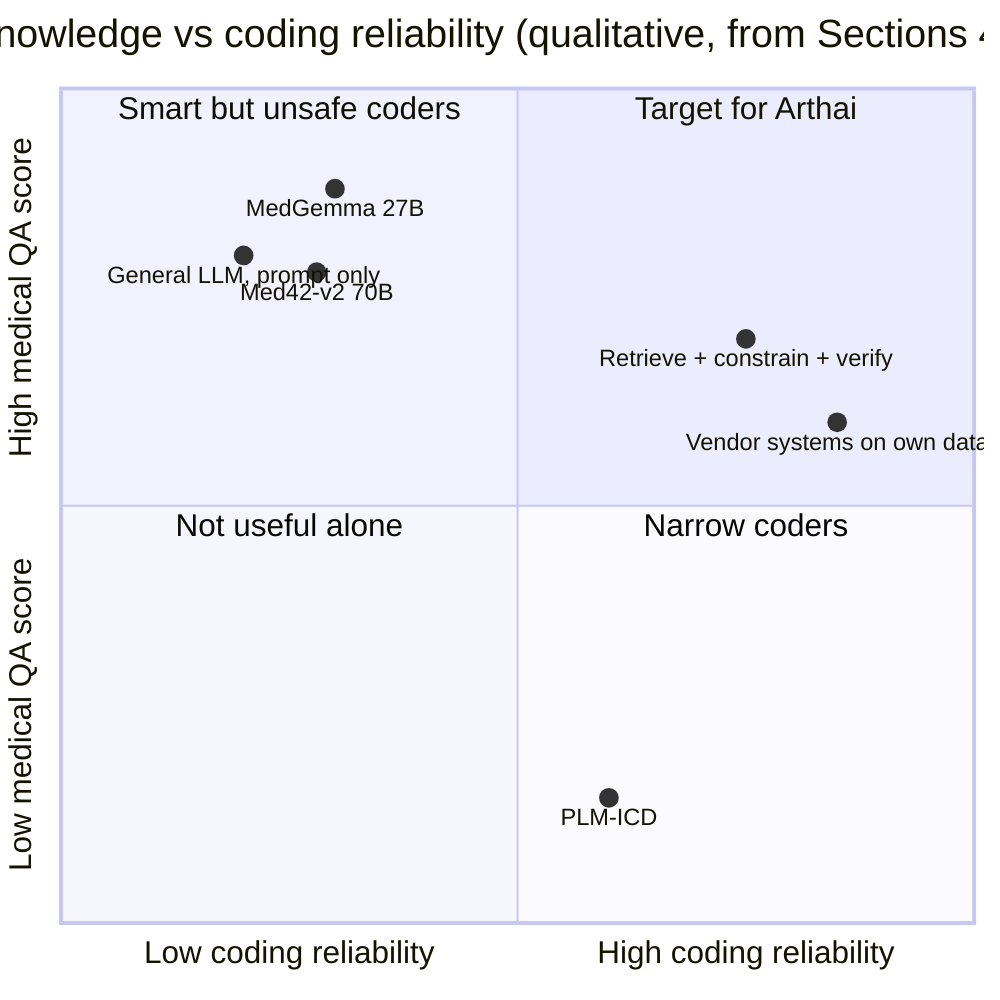
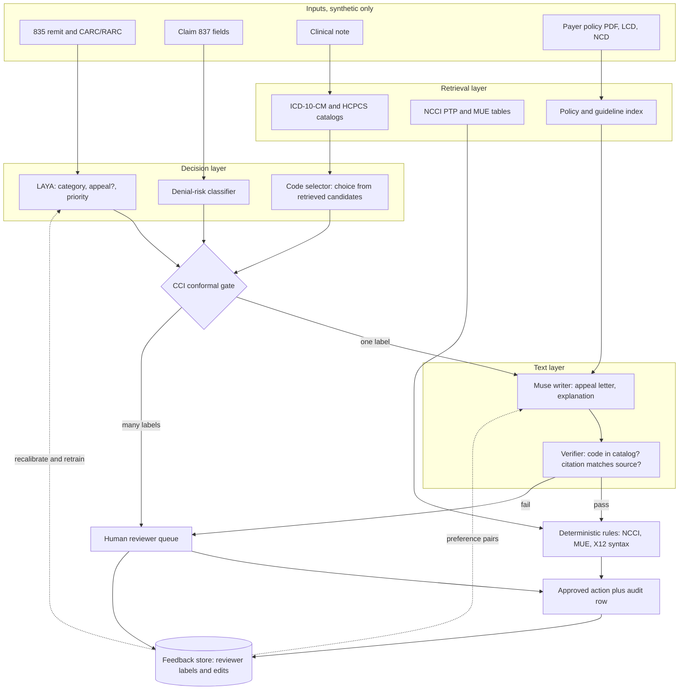
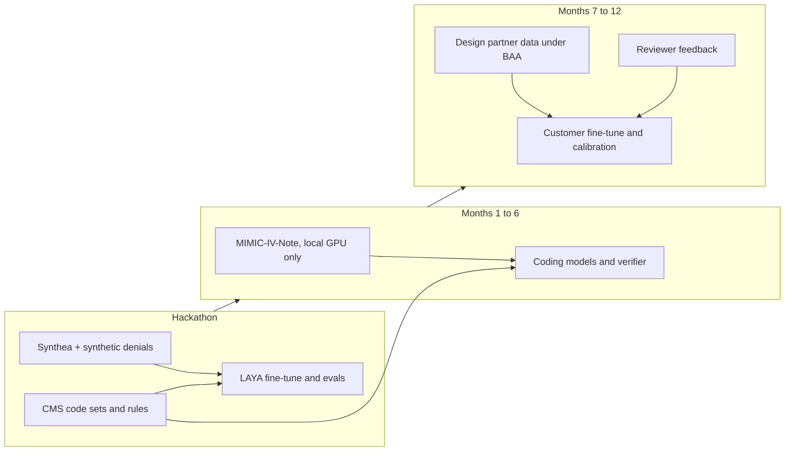
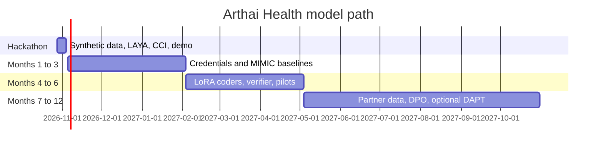

# Healthcare RCM models: options, build path, and data for Arthai Health

| Field | Value |
|---|---|
| Document type | Technical research report (explanation and reference) |
| Project | Arthai Health, Meta hackathon build (deadline 2026-11-04, 9:00 PM ET) |
| Date | 2026-10-28 |
| Status | Draft for review. Not a decision record. Decisions go in `DECISIONS.md`. |
| Writing standard | ASD-STE100 Simplified Technical English rules (short sentences, active voice, one idea for each sentence) |
| Data rule | Synthetic data only for the hackathon. No real PHI. See `docs/data-plan.md`. |
| Code rule | No code or material from the author's former or current employers. All approaches in this document come from public sources. |
| Internal sources | `docs/research/originals/build-guide.md` is on the PR #9 branch (not merged yet). `docs/research/rea-teardown.md` is in PR #13. The other `docs/` files are on `main`. |

## How to read this document

- Section 1 gives the answers. Read it first.
- Sections 2 to 4 describe the problem and the current models.
- Sections 5 to 8 describe how to build a state-of-the-art (SOTA) RCM model.
- Section 9 lists the data and the legal limits.
- Section 10 gives the recommended path, in phases.
- Each fact has a link to its source. A fact without a public source has the mark **UNVERIFIED**.
- A number that we calculated has the mark **ESTIMATE**. The calculation is in the text.

## Contents

1. [Summary and answers](#1-summary-and-answers)
2. [Scope, method, and rules](#2-scope-method-and-rules)
3. [Question 1: Do we need a model trained from scratch?](#3-question-1-do-we-need-a-model-trained-from-scratch)
4. [Question 2: Existing models and where they stand](#4-question-2-existing-models-and-where-they-stand)
5. [Question 3a: Architecture of a SOTA RCM model](#5-question-3a-architecture-of-a-sota-rcm-model)
6. [Question 3b: The training pipeline, step by step](#6-question-3b-the-training-pipeline-step-by-step)
7. [Question 3c: Compute and cost estimates](#7-question-3c-compute-and-cost-estimates)
8. [Question 3d: Evaluation benchmarks and metrics](#8-question-3d-evaluation-benchmarks-and-metrics)
9. [Question 4: Data, resources, licenses, and HIPAA](#9-question-4-data-resources-licenses-and-hipaa)
10. [Question 5: Recommended path in phases](#10-question-5-recommended-path-in-phases)
11. [Risks and open questions](#11-risks-and-open-questions)
12. [Glossary](#12-glossary)
13. [References](#13-references)

---

## 1. Summary and answers

### 1.1 Short answers

| Question | Short answer |
|---|---|
| 1. Do we need a model trained from scratch? | No. Not for the hackathon and not for the first year. Train small task models and adapt open models. Training from scratch is the last step, not the first. |
| 2. What exists now? | Open medical LLMs (MedGemma, Med42, OpenBioLLM, Meditron, BioMistral, Me-LLaMA) are good at medical exam questions. They are not good coders. Coding-specific models (PLM-ICD and newer 2026 research) reach about 0.5 to 0.6 micro-F1 on full ICD-10 label sets. Commercial vendors (AKASA, Fathom, Nym, CodaMetrix, Epic Penny) report high automation rates, but they train on customer data and do not publish open benchmarks. |
| 3. How do we build a SOTA RCM model? | Use a system, not one model: retrieval over the official code catalogs, a constrained choice from that catalog, a verifier, a small classifier for scores, and a conformal gate that sends uncertain cases to a human. Adapt the models with LoRA or QLoRA. Add preference tuning from reviewer feedback. This is the LAYA plus CCI plan that is already in `docs/research/originals/build-guide.md`. |
| 4. What data can we use? | Public code sets and CMS files (ICD-10-CM, HCPCS, NCCI, MUE, DE-SynPUF), Synthea, CARC and RARC lists, and public payer policies. MIMIC-IV-Note, eICU, and n2c2 need credentialing and a data use agreement. CPT needs an AMA license for commercial use. Real PHI needs a HIPAA basis and BAAs. We do not use real PHI. |
| 5. What is the path? | Hackathon: no new foundation model. Fine-tune LAYA on synthetic denials, calibrate it with cci-sdk, and use Meta models for text. Months 1 to 3: credentialed data and a coding baseline. Months 4 to 6: LoRA fine-tunes, verifier, and a real eval suite. Months 7 to 12: design-partner data under a BAA, preference tuning, and an optional domain-adaptive pretraining run. |

### 1.2 Key findings

1. **General LLMs are poor at code lookup.** In NEJM AI (2024), GPT-4 got 33.9% exact match on ICD-10-CM codes, 45.9% on ICD-9-CM, and 49.8% on CPT. Llama 2 70B Chat got 1.5% on ICD-10-CM ([Soroush et al., NEJM AI 2024](https://ai.nejm.org/doi/full/10.1056/AIdbp2300040)).
2. **Medical exam scores do not predict coding skill.** MedGemma 27B gets 87.7% on MedQA ([MedGemma model card](https://developers.google.com/health-ai-developer-foundations/medgemma/model-card-v1)). But in MedHELM, models performed worse on the "MIMIC-IV Billing Code" benchmark than on most other tasks ([MedHELM, arXiv 2505.23802](https://arxiv.org/html/2505.23802v1)).
3. **Medical pretraining often does not help.** In a controlled study, medical LLMs beat their own base models in only 12.1% of 3-shot cases. They were worse in 38.2% of cases ([Jeong et al., EMNLP 2024](https://aclanthology.org/2024.emnlp-main.677/)).
4. **The coding ceiling is still low on full label sets.** PLM-ICD gets 58.5 micro-F1 on MIMIC-IV ICD-10 ([Edin et al., SIGIR 2023](https://arxiv.org/abs/2304.10909)). A 2026 graph-constrained LLM policy gets 0.527 micro-F1 on the full 15,761-code space ([arXiv 2607.11954](https://arxiv.org/abs/2607.11954)). Rare codes are the main failure.
5. **Task-specific post-training is what moves coding accuracy.** A 2026 study found that supervised fine-tuning gives "the main capability jump" and that RL (GRPO) adds more ([arXiv 2606.13940](https://arxiv.org/abs/2606.13940)). Fine-tuning on 74,260 ICD-10 code-description pairs raised exact match from under 1% to 97% on the lookup task. On real clinical notes it got 69.20% exact match ([npj Health Systems 2025](https://pmc.ncbi.nlm.nih.gov/articles/PMC12045799/)).
6. **Retrieval plus constraints beats free generation.** MedCodER (extract, retrieve, re-rank) got 0.62 micro-F1 against 0.40 for PLM-ICD on its own ICD-10 evidence dataset ([NAACL 2025 Industry](https://aclanthology.org/2025.naacl-industry.37/); [arXiv 2409.15368](https://arxiv.org/html/2409.15368v1)). Tool access to the official ICD-10-CM references recovered up to 0.34 micro-F1 on hard injury and external-cause codes ([arXiv 2609.13806](https://arxiv.org/abs/2609.13806)).
7. **The commercial leaders train on customer data, not public data.** AKASA says that it fine-tunes models "for individual health systems" ([AKASA, 2026-10-02](https://akasa.com/press/autonomous-mid-cycle)). Nym gives an audit trail for every coded encounter ([Nym engine](https://nym.health/autonomous-medical-coding/nym-engine/)). Their moat is data access and audit, not model size.
8. **Denials are a large, under-served target.** HealthCare.gov insurers denied 19% of in-network claims in 2023. Consumers appealed fewer than 1% of the denied in-network claims ([KFF](https://www.kff.org/private-insurance/claims-denials-and-appeals-in-aca-marketplace-plans-in-2023/)). No public dataset has claim-level denial labels, so synthetic denials are the correct hackathon choice.

### 1.3 Recommended hackathon approach

- Do not train a foundation model. Fine-tune LAYA (about 421M parameters) on synthetic denials on Modal, then calibrate it with the cci-sdk statistics module. LAYA does the scores. Meta models do the text.
- Make every code and every policy citation come from a lookup in the official CMS files (ICD-10-CM, HCPCS, NCCI, MUE, CARC, RARC). The LLM selects from a closed list. A verifier checks each citation.
- Show the gate in the demo: conformal coverage against the target alpha, the human-review rate, and the audit row for each decision.

---

## 2. Scope, method, and rules

### 2.1 Scope

This document answers five questions from Sai (2026-10-28):

1. Does Arthai Health need a model trained from scratch on healthcare data?
2. What existing models fit RCM tasks, and how good are they?
3. How do we build a SOTA healthcare RCM model?
4. What data and resources exist, and what are the legal limits?
5. What is the path for the hackathon and for 3, 6, and 12 months?

### 2.2 Method

- We used free public sources only. These are papers (arXiv, ACL Anthology, NEJM AI, Nature, PMC), Hugging Face model cards, official pages (CMS, HHS, PhysioNet, AMA, X12), and vendor press pages.
- We opened each source and checked the numbers in it. We fetched the Edin et al. tables, the Meditron model card, the MedHELM paper, the Modal and Baseten price pages, and the arXiv abstracts directly.
- Vendor numbers are vendor claims. No independent party verified them. This document labels them "vendor-reported".
- Prices and dates are as of 2026-10-28. Prices change. Check the source before you spend credits.

### 2.3 Rules for this project

- Use synthetic data only for the hackathon. This is the rule in `docs/data-plan.md`.
- Do not send credentialed data (for example MIMIC) to an external API. PhysioNet prohibits this unless the service has verified zero retention ([PhysioNet, 2025-09-24](https://www.physionet.org/news/post/llm-responsible-use/)).
- Do not use code, prompts, data, or documents from the author's former or current employers.
- Do not reverse-engineer insurer, clearinghouse, or vendor software. Use only their public pages.

---

## 3. Question 1: Do we need a model trained from scratch?

### 3.1 Decision

No. Arthai Health does not need a model trained from scratch. The reasons follow.

### 3.2 Reasons

1. **Pretraining from scratch does not solve the main error.** The main coding error is a wrong or invented code. GPT-4 generated "imprecise or fabricated" codes in the NEJM AI study ([Soroush et al.](https://ai.nejm.org/doi/full/10.1056/AIdbp2300040)). A closed catalog and a verifier remove invented codes. More pretraining does not.
2. **Domain pretraining gives small or no gains on its own.** Medical LLMs beat their base models in only 12.1% of 3-shot cases ([Jeong et al., EMNLP 2024](https://aclanthology.org/2024.emnlp-main.677/)).
3. **Task fine-tuning gives the large gains.** SFT gave the main jump for generative ICD coding ([arXiv 2606.13940](https://arxiv.org/abs/2606.13940)). In the graph-constrained study, more supervised trajectory data was the only intervention that improved results in every setting ([arXiv 2607.11954](https://arxiv.org/abs/2607.11954)).
4. **The cost is out of range.** Meditron-70B used 42,496 A100 GPU-hours for 48B tokens of *continued* pretraining ([Meditron model card](https://huggingface.co/epfl-llm/meditron-70b)). That is not even from scratch. Our total compute credit is $100 on Modal and $100 on Baseten.
5. **The data does not exist for us.** GatorTron trained from scratch on more than 82 billion words of de-identified UF Health notes ([Yang et al., npj Digital Medicine 2022](https://www.nature.com/articles/s41746-022-00742-2)). Only a health system has that data. We do not.
6. **The hackathon theme requires Meta models.** The stack decision (`docs/adr/0004-stack.md`) makes Meta models the primary text models. A new model from scratch would not be a Meta model.

### 3.3 When training from scratch could make sense

Training a new model from scratch can make sense only when all of these are true:

- You have tens of billions of tokens of licensed clinical and claims text.
- You have a BAA and a legal basis for every source.
- You have a measured gap that adaptation of open models cannot close.
- You have a budget in the range of tens of thousands of dollars or more (see Section 7).

The likely first candidate is not a large LLM. It is a small encoder for claims and remits, like GatorTron for notes. Section 10 places this in months 7 to 12, as an option.

### 3.4 Where to start

Start with the task, not the model.

1. List the RCM decisions that the product makes (Section 4.1).
2. For each decision, pick the smallest model type that can do it.
3. Build a labeled synthetic eval set for each decision before you train anything.
4. Measure a prompt-only baseline with a Meta model.
5. Fine-tune only where the baseline fails the target.

---

## 4. Question 2: Existing models and where they stand

### 4.1 RCM tasks and the model type for each task

| RCM task | Input | Output | Best model type | Why |
|---|---|---|---|---|
| Diagnosis coding (ICD-10-CM) | Clinical note | Set of codes | Retrieve, then constrained choice, then verifier | Large label space. Free generation invents codes. |
| Procedure coding (CPT, HCPCS) | Note, order | Codes and modifiers | Same as above, plus NCCI and MUE rules | CPT is licensed. NCCI and MUE are deterministic. |
| Claim scrub (denial risk before submit) | Claim fields | Risk score, reason | Tabular classifier (gradient boosting) plus rules | Structured data. Needs a calibrated probability. Deep Claim predicted denial probability and reason codes from 2.9 million claims of two US health systems ([arXiv 2007.06229](https://arxiv.org/abs/2007.06229)). |
| Denial triage | 835 remit lines, CARC, RARC, notes | Category, appeal yes or no, priority | Small decision model (LAYA) plus conformal gate | Fast, cheap, typed outputs, abstains. |
| Root cause | Denial plus claim history | Cause category | Classifier plus LLM explanation | Explanation needs text. Score does not. |
| Appeal letter | Denial, chart facts, policy text | Letter with citations | LLM with RAG and a citation checker | Long text. Each claim must cite a source. |
| Payer policy reasoning | Policy PDFs, LCD, NCD | Coverage criteria met or not | RAG plus LLM plus rule checks | Policies change. Retrieval keeps them current. |
| Claim status and payer calls | IVR audio, portal text | Status fields | Speech to text, LLM, typed extraction | Real-time voice. Needs guardrails. |

### 4.2 Open models: summary table

All sizes and licenses come from the model cards. "Gated" means that you must accept terms or get credentialed access first.

| Model | Type | Size | License and access | Best published result | Fit for RCM | Main gap |
|---|---|---|---|---|---|---|
| [MedGemma 27B text](https://huggingface.co/google/medgemma-27b-text-it) (Google) | Decoder LLM, Gemma 3 base | 27B (also 4B multimodal) | Health AI Developer Foundations terms. Gated on HF. | MedQA 87.7% (0-shot), 89.8% (best-of-5) ([model card](https://developers.google.com/health-ai-developer-foundations/medgemma/model-card-v1)) | Strong open base for policy reasoning and letters. Fine-tunable. | Not a Meta model. No coding benchmark on the card. |
| [Med42-v2 70B](https://huggingface.co/m42-health/Llama3-Med42-70B) (M42) | Llama 3 70B, instruction and preference tuned | 8B and 70B | Llama 3 Community License | MedQA 79.10% zero-shot ([model card](https://huggingface.co/m42-health/Llama3-Med42-70B)) | Llama base, so it is close to the Meta theme. Good letter writer candidate. | 8k context. Not trained for codes. |
| [OpenBioLLM-70B](https://huggingface.co/aaditya/Llama3-OpenBioLLM-70B) (Saama) | Llama 3 70B fine-tune | 8B and 70B | Llama 3 license | MedQA 76.90 in the Med42-v2 comparison ([Med42-v2 card](https://huggingface.co/m42-health/Llama3-Med42-70B)) | Biomedical QA | Lowest Elo of the 70B models in the Med42 clinical Elo table ([Med42-v2 card](https://huggingface.co/m42-health/Llama3-Med42-70B)). |
| [Meditron-70B](https://huggingface.co/epfl-llm/meditron-70b) (EPFL) | Llama 2 70B, continued pretraining on 48B tokens | 7B and 70B | Llama 2 license (model), Apache-2.0 (code) | MedQA 64.4, MedQA-4-option 70.2, after task fine-tuning ([model card](https://huggingface.co/epfl-llm/meditron-70b)) | Reference for the cost of domain-adaptive pretraining | 4k context. Base model only. The card advises against production use. |
| [BioMistral-7B](https://huggingface.co/BioMistral/BioMistral-7B) | Mistral 7B, continued pretraining on PubMed Central | 7B | Apache-2.0 | MedQA 50.6% after SFT, 3-shot ([model card](https://huggingface.co/BioMistral/BioMistral-7B)) | Small, permissive license. Good for cheap experiments. | Weak on clinical reasoning compared with newer models. |
| [Me-LLaMA](https://www.physionet.org/content/me-llama/1.0.0/) (Yale and others) | Llama 2, continued pretraining on 129B tokens incl. MIMIC notes | 13B and 70B | PhysioNet Credentialed Health Data License. Credentialed access only. | See paper ([PMC11142305](https://pmc.ncbi.nlm.nih.gov/articles/PMC11142305/)) | Has clinical-note pretraining | Credentialed. Same API limits as MIMIC. Old Llama 2 base. |
| [GatorTron](https://huggingface.co/UFNLP/gatortron-base) (UF Health and NVIDIA) | Encoder (BERT-style), from scratch | Up to 8.9B | Apache-2.0 on HF (base, large) | Gains on clinical NLI and medical QA ([npj Digit Med 2022](https://www.nature.com/articles/s41746-022-00742-2)) | Good encoder for classification and extraction on notes | Encoder only. Does not write text. |
| [Bio_ClinicalBERT](https://huggingface.co/emilyalsentzer/Bio_ClinicalBERT) | Encoder, trained on MIMIC-III notes | About 110M | MIT | Clinical NLP baselines ([Alsentzer et al., 2019](https://arxiv.org/html/1904.03323v3)) | Cheap classifier backbone | 512-token limit. Old. |
| [PLM-ICD](https://aclanthology.org/2022.clinicalnlp-1.2/) | Encoder plus label attention for ICD coding | About 139M ([Edin et al.](https://arxiv.org/html/2304.10909v1)) | Code in the paper repo. Weights need MIMIC access. | MIMIC-III full micro-F1 59.8; MIMIC-IV ICD-10 58.5 ([Edin et al.](https://arxiv.org/abs/2304.10909)) | Standard coding baseline | Never predicted 51.8% of ICD-10 diagnosis codes in the test set correctly ([Edin et al.](https://arxiv.org/html/2304.10909v1)). |
| [LAYA](https://huggingface.co/convaiinnovations/laya) (ConvAI Innovations) | System-1 decision model (choice, score, yes or no) | About 421M (`docs/laya-plan.md`) | Apache-2.0 ([HF](https://huggingface.co/convaiinnovations/laya)) | No public RCM benchmark | Our triage and gate model. One pass, typed outputs, confidence. | Weeks old. Not trained on RCM yet. Raw confidence is not calibrated. |

Reference system (not open):

| System | What it is | Size | Result | Lesson for us |
|---|---|---|---|---|
| [Polaris](https://arxiv.org/abs/2403.13313) (Hippocratic AI) | A "constellation" of LLMs for patient voice calls: one primary agent plus specialist support agents | About one trillion parameters in total ([arXiv 2403.13313](https://arxiv.org/abs/2403.13313)) | Rated on par with human nurses by more than 1,100 nurses and 130 physicians, on aggregate ([arXiv 2403.13313](https://arxiv.org/abs/2403.13313)) | Safety comes from specialist checker agents around the talker. Use the same pattern for the payer-call agent, at small scale. |
| [Med-PaLM 2](https://www.nature.com/articles/s41591-024-03423-7) (Google) | Medical QA LLM | Not published | MedQA 86.5% ([Nature Medicine 2025](https://www.nature.com/articles/s41591-024-03423-7)) | Closed. Google deprecated MedLM on 2025-05-14 and ended access on 2025-09-29 ([Vertex AI release notes](https://cloud.google.com/vertex-ai/generative-ai/docs/release-notes)). MedGemma is the open path now. |

### 4.3 Coding-specific research: where the state of the art is

The table shows only results that we read in the source.

| Method | Dataset | Metric | Result | Source |
|---|---|---|---|---|
| GPT-4 (prompt only, code from description) | Mount Sinai codes, ICD-10-CM | Exact match | 33.9% | [NEJM AI 2024](https://ai.nejm.org/doi/full/10.1056/AIdbp2300040) |
| GPT-4 (prompt only) | Mount Sinai codes, CPT | Exact match | 49.8% | [NEJM AI 2024](https://ai.nejm.org/doi/full/10.1056/AIdbp2300040) |
| PLM-ICD | MIMIC-III full | Micro-F1 | 59.8 | [Huang et al., 2022](https://aclanthology.org/2022.clinicalnlp-1.2/) |
| PLM-ICD (reproduced) | MIMIC-IV ICD-10 | Micro-F1 / macro-F1 | 58.5 / 21.1 | [Edin et al., 2023](https://arxiv.org/html/2304.10909v1) |
| PLM-ICD (reproduced) | MIMIC-IV ICD-9 | Micro-F1 | 62.6 | [Edin et al., 2023](https://arxiv.org/html/2304.10909v1) |
| MedCodER (extract, retrieve, re-rank) | ACI-BENCH extension with evidence, ICD-10 | Micro-F1 | 0.60 (arXiv), 0.62 (NAACL) | [arXiv 2409.15368](https://arxiv.org/abs/2409.15368), [NAACL 2025](https://aclanthology.org/2025.naacl-industry.37/) |
| PLM-ICD on the same dataset | Same | Micro-F1 | 0.40 | [arXiv 2409.15368](https://arxiv.org/html/2409.15368v1) |
| Fine-tuned LLM (GPT-4o mini, Llama) | Real clinical notes | Exact / category match | 69.20% / 87.16% | [npj Health Systems 2025](https://pmc.ncbi.nlm.nih.gov/articles/PMC12045799/) |
| Graph-constrained LLM policy (SFT-1+) | MIMIC-IV, 50 codes / full 15,761 codes | Micro-F1 | 0.709 / 0.527 | [arXiv 2607.11954](https://arxiv.org/abs/2607.11954) (preprint) |
| Agentic coder with ICD-10-CM reference tools | MIMIC-IV, injury and external-cause subset | Micro-F1 recovered | Up to 0.34 | [arXiv 2609.13806](https://arxiv.org/abs/2609.13806) (preprint) |

Notes:

- Different datasets and splits make these numbers hard to compare. Edin et al. showed that earlier papers calculated macro-F1 in a sub-optimal way. Their correction doubles it ([Edin et al.](https://arxiv.org/abs/2304.10909)).
- Micro-F1 rewards common codes. Macro-F1 shows the rare-code problem. Report both.
- The 2026 results are preprints. No peer review yet.

### 4.4 Commercial products

These numbers are vendor-reported unless the row says otherwise.

| Company and product | What it does | How it is built (public statements) | Reported result | Gap or caution |
|---|---|---|---|---|
| [AKASA](https://akasa.com/press/autonomous-mid-cycle) autonomous mid-cycle, Coding Optimizer | Inpatient coding, CDI, prebill review | "Fine-tunes AI models for individual health systems." Custom models trained on each system's documentation, case mix, and coding decisions ([AKASA](https://akasa.com/press/autonomous-mid-cycle)) | Matched or beat human coders on MS-DRG, principal diagnosis, and POA in third-party blinded tests. Codes in under 90 seconds after discharge ([AKASA, 2026-10-02](https://akasa.com/press/autonomous-mid-cycle)) | The study is not public. |
| [Fathom](https://fathomhealth.com/insights/fathom-achieves-95-5-overall-performance-score-in-klas-research-autonomous-coding-report-with-customers-validating-90-automation-rates) | Autonomous outpatient and ED coding | Deep learning and NLP. In the Epic Toolbox ([Business Wire, 2024-09-12](https://www.businesswire.com/news/home/20240912928979/en/Fathom-Autonomous-Medical-Coding-Available-in-Epic-Toolbox)) | 95.5% automation at 98.3% accuracy at one customer ([Fathom](https://fathomhealth.com/insights/your-health-deploys-fathom-autonomous-medical-coding-to-achieve-95-5-automation-rate-at-98-3-accuracy-rate-across-all-service-lines)) | Automation rate depends on which encounters the vendor counts as eligible. |
| [Nym](https://nym.health/autonomous-medical-coding/nym-engine/) | Autonomous coding in six service lines | Audit trail for every coded encounter that links codes to documentation and guidelines. Exceptions go to coders ([Nym](https://nym.health/autonomous-medical-coding/nym-engine/)) | $1.3M lower annual ED coding cost at Inova ([Nym](https://nym.health/autonomous-medical-coding/nym-engine/)) | No public accuracy benchmark. |
| [CodaMetrix](https://www.codametrix.com/case-studies/mgb-case-study) | Multi-specialty autonomous coding, from Mass General Brigham | Learns from longitudinal clinical records | 85% of radiology and 73% of pathology coding automated. Coding-related denials cut by 58.7% at MGB ([CodaMetrix](https://www.codametrix.com/case-studies/mgb-case-study)) | Case study, not a controlled trial. |
| [Epic Penny](https://www.fiercehealthcare.com/ai-and-machine-learning/epic-rolls-out-ai-charting-and-more-built-automation-clinicians-and) | Coding suggestions and denial appeal letters inside Epic | Uses models through Microsoft Azure for AI features ([Fierce Healthcare, 2026-02-05](https://www.fiercehealthcare.com/ai-and-machine-learning/epic-rolls-out-ai-charting-and-more-built-automation-clinicians-and)) | More than 200 organizations use it. Many see more than 20% fewer coding-related denials. Medical-necessity appeal letters 23% faster ([Fierce](https://www.fiercehealthcare.com/ai-and-machine-learning/epic-rolls-out-ai-charting-and-more-built-automation-clinicians-and)) | Inside Epic only. Strong distribution advantage. |
| Google MedLM | Medical LLM on Vertex AI | — | — | Deprecated 2025-05-14. Access ended 2025-09-29 ([release notes](https://cloud.google.com/vertex-ai/generative-ai/docs/release-notes)). |
| Anthropic and OpenAI healthcare offerings | General LLM platforms with healthcare features | Anthropic announced "Claude for Healthcare" with connections to the CMS Coverage Database and ICD-10 codes ([Fierce](https://www.fiercehealthcare.com/ai-and-machine-learning/epic-rolls-out-ai-charting-and-more-built-automation-clinicians-and)) | — | Shows that tool access to the code catalogs is now the standard pattern. |

For denial and appeal vendors (Waystar, Experian, R1, Infinitus), see the REA teardown in PR #13 (`docs/research/rea-teardown.md`).

### 4.5 Where the field stands, in one view

The positions are qualitative. They summarize the tables. They are not measured values.

### 4.6 Gaps in the field that Arthai can use

1. **No public calibrated abstention.** Vendors report automation rates. We found no vendor that publishes a coverage guarantee for its "send to human" decision. This was also the finding in the build guide.
2. **Rare codes fail.** All flat classifiers struggle with rare codes ([Edin et al.](https://arxiv.org/abs/2304.10909)). A conformal gate can route these cases to a human with a stated error rate.
3. **Injury and external-cause codes need guideline steps.** Workflow systems "score near zero" on them ([arXiv 2609.13806](https://arxiv.org/abs/2609.13806)). Tool access to the guidelines helps.
4. **No public denial dataset.** Public data has denial rates but not reasons at claim level ([KFF](https://www.kff.org/private-insurance/healthcare-gov-insurers-denied-nearly-1-in-5-in-network-claims-in-2023-but-information-about-reasons-is-limited-in-public-data/)). A good synthetic denial generator is an asset.

---

## 5. Question 3a: Architecture of a SOTA RCM model

### 5.1 The design principle

A SOTA RCM "model" is a system. Each part does one job:

- A **retriever** finds candidate codes, rules, and policy clauses in the official sources.
- A **decision model** selects from the candidates and gives a probability for each choice.
- A **calibration gate** turns the probabilities into a set with a stated error rate. If the set has more than one answer, a human decides.
- A **writer** (an LLM) writes text only from facts and citations that the system already checked.
- A **verifier** checks each output against the catalog and the cited text.
- **Deterministic rules** (NCCI, MUE, X12 syntax) run before anything goes out.

The reason is simple. The LLM is good at reading and writing. It is bad at recall of exact codes ([NEJM AI 2024](https://ai.nejm.org/doi/full/10.1056/AIdbp2300040)). So the system does not ask the LLM to recall codes.

### 5.2 Architecture options compared

| Option | What it is | Strength | Weakness | Use in Arthai |
|---|---|---|---|---|
| Training from scratch | New model, random weights, own corpus | Full control of data and tokenizer | Very high cost. Needs very large licensed data. See GatorTron ([npj 2022](https://www.nature.com/articles/s41746-022-00742-2)). | No. Option in months 7 to 12 for a small claims encoder only. |
| Domain-adaptive pretraining (DAPT) | Continue next-token training on domain text | Helps in some domains ([Gururangan et al., ACL 2020](https://aclanthology.org/2020.acl-main.740/)) | Medical DAPT often gives no gain over the base ([Jeong et al., 2024](https://aclanthology.org/2024.emnlp-main.677/)). High cost. | Not for the hackathon. Test it only after the eval suite exists. |
| Full fine-tuning (SFT) | Update all weights on labeled task data | Largest gain on a fixed task ([arXiv 2606.13940](https://arxiv.org/abs/2606.13940)) | High memory. Risk of forgetting. | Small models only (LAYA, encoders). |
| LoRA | Freeze the base. Train small low-rank matrices. | Up to 10,000 times fewer trainable parameters and about 3 times less GPU memory than full fine-tuning of GPT-3 ([Hu et al., 2021](https://arxiv.org/abs/2106.09685)) | Slightly lower ceiling on some tasks | Default method for 7B to 70B models after the hackathon. |
| QLoRA | LoRA on a 4-bit quantized base | Fine-tunes a 65B model on one 48 GB GPU ([Dettmers et al., 2023](https://arxiv.org/abs/2305.14314)) | Slower steps. Quantization noise. | Default when GPU memory is the limit. |
| RAG over code catalogs and policies | Retrieve the code list, guideline text, and policy clauses at run time | Current data. Citations. No retraining when codes change. | Retrieval misses make the answer wrong | Yes. Required for coding and appeals. |
| Constrained decoding | The decoder can only emit tokens that match a list or a grammar | No invented codes. Valid JSON every time. vLLM supports choice lists, regex, JSON schema, and grammars ([vLLM docs](https://docs.vllm.ai/en/stable/features/structured_outputs/)) | Works only with self-hosted or compatible APIs | Yes, for any self-hosted model. For hosted APIs, validate the output against the list instead. |
| Hierarchy-constrained policy | The model walks the ICD tree level by level | Valid leaf codes by construction. Better rare-code macro-F1 ([arXiv 2607.11954](https://arxiv.org/abs/2607.11954)) | New, preprint only | Watch. Try in months 4 to 6. |
| Verifier model or checker | A second model or rule set checks each code or citation | Catches errors before a human sees them. Polaris uses specialist checker agents ([arXiv 2403.13313](https://arxiv.org/abs/2403.13313)) | Extra latency and cost | Yes. Citation checker for appeals. Code checker for coding. |
| Classifier plus conformal calibration | A small model gives scores. Conformal prediction turns scores into sets with a coverage guarantee ([Angelopoulos and Bates](https://arxiv.org/abs/2107.07511)) | Stated error rate on the auto path. Cheap. | Guarantee holds only if new data is exchangeable with the calibration data | Yes. This is LAYA plus CCI. |

### 5.3 How the LAYA plus CCI plan fits

The build guide (`docs/research/originals/build-guide.md`) already has this plan:

- LAYA makes typed decisions: category, appeal yes or no, priority. It answers all questions in one forward pass with a confidence for each answer (`docs/laya-plan.md`).
- The cci-sdk gate turns LAYA scores into conformal sets. The cci-sdk `stats` module does conformal prediction, Venn-Abers calibration, and e-values with NumPy only. It makes no network calls ([cci-sdk README](https://github.com/rahvis/cci-sdk)).
- If the set has one label, the claim takes the automatic path. If the set has more than one label, the claim goes to a human.
- Muse (Meta) writes the letter and explains the decision. Muse does not make the decision.
- The build guide states the rule: "Codes should come from a constrained catalog plus a verifier, which is Laya plus CCI's job."

The research in Section 4 supports this plan:

- The REA teardown found that a leading voice vendor saw accuracy drop with LLM-only extraction. The teardown recommended a separate scorer. LAYA fills that role.
- The rare-code failures ([Edin et al.](https://arxiv.org/abs/2304.10909)) are the cases where a conformal set gets wide. The gate sends them to a human.
- THCM-Cal applied split conformal prediction to multi-label ICD coding on MIMIC-III and MIMIC-IV ([EMNLP Findings 2025](https://aclanthology.org/2025.findings-emnlp.48/)). So conformal methods work on this label type.

Two limits apply:

1. The conformal guarantee is marginal. It covers the average over cases like the calibration set. It is not a promise about one claim ([cci-sdk README](https://github.com/rahvis/cci-sdk)).
2. LAYA's base checkpoint warns that some calibration temperatures are invalid. Do not trust raw LAYA confidence before calibration (`docs/laya-plan.md`).

### 5.4 Reference architecture

---

## 6. Question 3b: The training pipeline, step by step

### 6.1 Overview

```mermaid
flowchart LR
    S1[Step 1: Define tasks and label schema] --> S2[Step 2: Collect data]
    S2 --> S3[Step 3: Preprocess and split]
    S3 --> S4[Step 4: De-identify and scan]
    S4 --> S5[Step 5: Optional DAPT]
    S5 --> S6[Step 6: SFT with LoRA or QLoRA]
    S4 --> S6
    S6 --> S7[Step 7: Preference tuning, DPO]
    S7 --> S8[Step 8: Calibrate: temperature, then conformal]
    S8 --> S9[Step 9: Evaluate]
    S9 --> S10[Step 10: Red-team]
    S10 --> S11[Step 11: Deploy]
    S11 --> S12[Step 12: Monitor drift and coverage]
    S12 --> S13[Step 13: Retrain from human feedback]
    S13 --> S6
```

### 6.2 The steps

**Step 1. Define the tasks and the label schema.**

1. Write one schema for each decision in Section 4.1.
2. For each label, write a definition and two examples.
3. Map each denial category to its CARC groups and RARC codes. The CARC and RARC lists are public on the X12 site ([CARC](https://x12.org/codes/claim-adjustment-reason-codes), [RARC](https://x12.org/codes/remittance-advice-remark-codes)).
4. Write the target metric for each task before you collect data.

**Step 2. Collect the data.**

1. Download the public code sets and rule tables (Section 9.1).
2. Generate synthetic patients and claims with Synthea. Synthea exports FHIR, C-CDA, and CSV, including claims and claim transactions ([Synthea wiki](https://github.com/synthetichealth/synthea/wiki/Claims,-Payers,-and-Insurance)).
3. Generate synthetic denials with the generator in `docs/laya-plan.md`. Use fixed seeds.
4. Optional, later: get credentialed access to MIMIC-IV-Note for coding work (Section 9.3).

**Step 3. Preprocess and split.**

1. Pin one code-set version for each experiment. ICD-10-CM changes each fiscal year on October 1 ([CMS ICD-10](https://www.cms.gov/medicare/coding-billing/icd-10-codes)). NCCI files change each quarter ([CMS NCCI PTP](https://www.cms.gov/medicare/coding-billing/national-correct-coding-initiative-ncci-edits/medicare-ncci-procedure-procedure-ptp-edits)).
2. Split by template, payer, and patient, not by row. This keeps near-duplicates out of the test set.
3. Keep three held-out sets: validation, calibration, and test. The calibration set must not touch training.
4. Do not remove digits from notes. PLM-ICD failed on BMI and gestation codes because preprocessing removed all digits ([Edin et al.](https://arxiv.org/html/2304.10909v1)).

**Step 4. De-identify and scan.**

1. For real data under HIPAA, use one of the two HIPAA methods. Safe Harbor removes 18 identifier types and requires no actual knowledge of re-identification risk. Expert Determination uses a qualified expert ([HHS guidance](https://www.hhs.gov/hipaa/for-professionals/special-topics/de-identification/index.html); [45 CFR 164.514](https://www.ecfr.gov/current/title-45/subtitle-A/subchapter-C/part-164/subpart-E/section-164.514)).
2. Use a detector such as Presidio for PII detection and anonymization. Presidio is open source (MIT) ([Presidio](https://github.com/microsoft/presidio/tree/main/presidio-anonymizer)). A tool alone does not make data "de-identified" under HIPAA. The method does.
3. For synthetic data, run a PHI scan anyway. Fail the build if the scan finds an SSN, a phone number, or a real-looking MRN (`docs/laya-plan.md`).

**Step 5. Domain-adaptive pretraining (optional).**

1. Skip this step until the eval suite shows a gap that SFT cannot close.
2. If you run it, mix general data back in. Meditron added 400M tokens of general "replay" data to 48B medical tokens ([Meditron card](https://huggingface.co/epfl-llm/meditron-70b)).
3. Compare against the base model on the same tasks. Medical DAPT often does not beat the base ([Jeong et al.](https://aclanthology.org/2024.emnlp-main.677/)).

**Step 6. Supervised fine-tuning (SFT) with LoRA or QLoRA.**

1. For LAYA: run `laya-train` on the synthetic JSONL on one L4 or A10G GPU on Modal (`docs/laya-plan.md`).
2. For a 7B to 27B LLM: use LoRA. Use QLoRA if the model does not fit in GPU memory ([QLoRA](https://arxiv.org/abs/2305.14314)).
3. Train the coder to select from retrieved candidates, not to recall codes. The npj study shows that code-description pairs alone teach lookup well (97% exact) but real notes are harder (69.20%) ([npj Health Systems 2025](https://pmc.ncbi.nlm.nih.gov/articles/PMC12045799/)).
4. For appeal letters: train on (denial, facts, policy clause) to (letter with citations) pairs. Each citation must point to a retrieved chunk ID.

**Step 7. Preference tuning.**

1. Collect pairs: the model draft (rejected) and the reviewer's edited version (chosen).
2. Train with DPO. DPO uses a simple classification loss on preference pairs. It needs no separate reward model and no PPO sampling ([Rafailov et al., 2023](https://arxiv.org/abs/2305.18290)).
3. For coding, RL with a verifiable reward (exact code-set match) is an option. GRPO improved code-set prediction beyond SFT in one 2026 study ([arXiv 2606.13940](https://arxiv.org/abs/2606.13940)). Another 2026 study found no gain from GRPO over matched supervised data ([arXiv 2607.11954](https://arxiv.org/abs/2607.11954)). Test it. Do not assume it.

**Step 8. Calibrate.**

1. Fit temperature scaling on the validation set.
2. Fit the conformal threshold on the calibration set with cci-sdk for a target alpha (for example alpha = 0.05 for 95% coverage).
3. Record the alpha, the calibration set hash, and the threshold in the audit row of each decision. The build guide lists these fields.

**Step 9. Evaluate.**

1. Run the eval suite in Section 8 for every model version.
2. Compare against the prompt-only baseline and the last released version.
3. Block a release if a metric drops below its target.

**Step 10. Red-team.**

1. Test prompt injection in payer documents and call transcripts. The build guide lists Prompt Guard for this.
2. Test PHI leaks: ask the model to repeat member IDs. Scan the outputs.
3. Test invented citations: give a denial with no matching policy. The correct output is "no basis found", not a letter.
4. Test code-set version errors: give a note dated in the previous fiscal year.

**Step 11. Deploy.**

1. Serve self-hosted models with vLLM and structured outputs ([vLLM](https://docs.vllm.ai/en/stable/features/structured_outputs/)).
2. Run LAYA on Modal or on CPU. Call Meta models through the configured provider (`docs/adr/0004-stack.md`).
3. Log one audit row for each decision: inputs hash, model version, probabilities, conformal set, alpha, reviewer action.

**Step 12. Monitor.**

1. Sample audited cases each week. Measure empirical coverage against 1 minus alpha.
2. If coverage drops below the target, recalibrate. The build guide lists "calibration drift" as a risk with this fix.
3. Re-run the eval suite when CMS releases new code files.

**Step 13. Retrain from human feedback.**

1. Add reviewer labels to the training set.
2. Add reviewer edits to the preference set.
3. Retrain on a fixed schedule, not after each edit. Recalibrate after each retrain.

---

## 7. Question 3c: Compute and cost estimates

### 7.1 Prices used

| Provider | GPU | Price | Source |
|---|---|---|---|
| Modal | L4 | $0.000222 per second (about $0.80 per hour) | [Modal pricing](https://modal.com/pricing) |
| Modal | A10 | $0.000306 per second (about $1.10 per hour) | [Modal pricing](https://modal.com/pricing) |
| Modal | L40S | $0.000542 per second (about $1.95 per hour) | [Modal pricing](https://modal.com/pricing) |
| Modal | A100 80 GB | $0.000694 per second (about $2.50 per hour) | [Modal pricing](https://modal.com/pricing) |
| Modal | H100 SXM5 | $0.001097 per second (about $3.95 per hour) | [Modal pricing](https://modal.com/pricing) |
| Baseten | A100 80 GB | $0.06667 per minute (about $4.00 per hour) | [Baseten pricing](https://www.baseten.co/pricing/) |
| Baseten | H100 80 GB | $0.10833 per minute ($6.50 per hour), for deploy and training | [Baseten pricing](https://www.baseten.co/pricing/) |
| Meta Model API | Muse Spark | $1.25 input, $4.25 output, per 1M tokens (Standard) | `docs/adr/0004-stack.md` (verified there against the Meta pricing page) |

Modal bills CPU and memory separately from the GPU ([Modal pricing](https://modal.com/pricing)).

### 7.2 How we estimate training compute

We scale from one measured run. Meditron-70B used 42,496 A100 GPU-hours to train 70B parameters on 48B tokens ([Meditron card](https://huggingface.co/epfl-llm/meditron-70b)). Training compute grows with (parameters × tokens). So:

> A100-hours ≈ 42,496 × (P / 70B) × (T / 48B)

P is the parameter count. T is the number of training tokens. This is a rough rule. It ignores differences in software efficiency. All results in Section 7.3 are **ESTIMATES**.

### 7.3 Estimates

| Job | Size | Calculation | A100-hours | Cost on Modal A100 80 GB |
|---|---|---|---|---|
| LAYA fine-tune (hackathon) | 421M params, 5k to 20k rows | From `docs/laya-plan.md`: 0.5 to 1.5 hours on L4 | (L4) 0.5 to 1.5 | $0.40 to $1.20 (L4) |
| LoRA SFT, 8B model | 20k examples × 1k tokens × 3 epochs = 60M tokens | 42,496 × (8/70) × (0.06/48) | about 6 | about $15 (range $8 to $40 with overhead) |
| LoRA SFT, MedGemma 27B | Same 60M tokens | 42,496 × (27/70) × (0.06/48) | about 20 | about $50 |
| DPO, 8B model | 5k pairs × 2k tokens × 2 epochs = 20M tokens | About two forward passes per pair, so about 2 × the SFT rate | about 4 | about $10 |
| DAPT, 8B model | 10B tokens | 42,496 × (8/70) × (10/48) | about 1,000 | about $2,500 |
| DAPT, 70B model | 48B tokens | Meditron measured value | 42,496 | about $106,000 |
| From scratch, 8B model | 1T tokens | 42,496 × (8/70) × (1000/48) | about 101,000 | about $253,000 |

LoRA updates fewer weights, but it still runs full forward and backward passes. So we use the same rate as full training. This makes the LoRA estimate high, not low.

For scale: the compute-optimal token count is about 20 tokens for each parameter ([Hoffmann et al., 2022](https://arxiv.org/abs/2203.15556)). An 8B model needs about 160B tokens by that rule. Modern models train on many more tokens. The 1T-token row uses that larger number.

### 7.4 Inference cost for one denied claim (hackathon)

The build guide gives the token budget for one denied claim with an appeal: about 9,500 input and 1,700 output tokens.

> Cost ≈ 9,500 × $1.25 / 1M + 1,700 × $4.25 / 1M ≈ $0.0119 + $0.0072 ≈ $0.019

This is an **ESTIMATE** for Muse Spark in Standard mode. The $150 Meta credit covers about 7,800 such claims at this rate. The ADR estimate of 30,000 calls uses smaller calls. LAYA calls cost nothing on CPU.

### 7.5 What fits in the hackathon credits

| Credit | Amount | What it covers (ESTIMATE) |
|---|---|---|
| Modal | $100 (plus $30 per month Starter credit, per the ADR) | LAYA fine-tune many times over. One LoRA SFT run on an 8B model is also possible. |
| Baseten | $100 | Muse Spark Open inference, per the ADR. Not enough for serious training at $6.50 per H100 hour. |
| Meta Model API | $150 | Appeal letters, explanations, synthetic data paraphrase, evals. |

DAPT and training from scratch do not fit. This confirms Section 3.

---

## 8. Question 3d: Evaluation benchmarks and metrics

### 8.1 Public benchmarks

| Benchmark | What it tests | Access | Use for Arthai |
|---|---|---|---|
| MIMIC-IV ICD-10 split (Edin et al.) | Multi-label ICD-10 coding on discharge summaries. 122,279 documents, 7,942 codes in the split ([Edin et al.](https://arxiv.org/html/2304.10909v1)) | Credentialed (MIMIC-IV) | Coding baseline after the hackathon. Use their code and splits ([repo](https://github.com/JoakimEdin/medical-coding-reproducibility)). |
| MedCodER evidence dataset | ICD-10 codes with diagnoses and supporting evidence text | Public on Zenodo ([10.5281/zenodo.13308316](https://zenodo.org/records/13308316)). License: CC BY-NC-ND 4.0 (non-commercial, no derivatives). | Evidence-grounded coding eval for research only. Do not use it to train a commercial model. |
| CodiEsp | 1,000 Spanish clinical cases coded in ICD-10 (CIE-10) ([Zenodo](https://zenodo.org/records/3837305)) | Public, CC BY 4.0 | Second-language and generalization test. |
| MedHELM | 35 benchmarks in 5 categories, including "MIMIC-IV Billing Code" and an Administration and Workflow category ([MedHELM](https://medhelm.org/medhelm); [arXiv 2505.23802](https://arxiv.org/html/2505.23802v1)) | Mixed: public, gated, private | Use its task framing for admin tasks. |
| MedQA, MedMCQA, PubMedQA | Medical exam and literature QA | Public | Sanity check only. These do not measure RCM skill. |
| HealthBench | 5,000 multi-turn health conversations, rubrics from 262 physicians ([OpenAI](https://openai.com/index/healthbench/); [arXiv 2505.08775](https://arxiv.org/abs/2505.08775)) | Public | Conversation safety for the voice agent. |

### 8.2 Arthai metrics, for each task

| Task | Metric | Target for the demo (proposal) |
|---|---|---|
| Denial triage (LAYA) | Accuracy, macro-F1, ECE (expected calibration error) | Set after the first baseline run |
| CCI gate | Empirical coverage against 1 minus alpha, average set size, abstention rate | Coverage within 2 points of the target |
| Coding | Exact match, micro-F1 and macro-F1, hierarchical near-miss rate, invalid-code rate | Invalid-code rate = 0 (by construction) |
| Appeal letters | Citation violation rate, rubric score (LLM judge plus hand spot-check) | Citation violations = 0 on the demo set |
| Claim scrub | AUROC, precision at fixed recall, NCCI and MUE rule hit rate | Set after baseline |
| Voice agent | Task success rate, turn latency, safety rubric | Set after baseline |
| System | Cost per claim, tokens per claim, p95 latency | Show on the dashboard |

The build guide already lists most of these metrics. This table adds the coding metrics and the invalid-code rate.

---
## 9. Question 4: Data, resources, licenses, and HIPAA

### 9.1 Public code sets and rule files (free, no PHI)

| Resource | Content | Access and license | Use |
|---|---|---|---|
| [ICD-10-CM files (CMS)](https://www.cms.gov/medicare/coding-billing/icd-10-codes), also on the [CDC site](https://www.cdc.gov/nchs/icd/icd-10-cm/files.html) | Code descriptions, tabular, index, addenda, guidelines. FY2026 files took effect on 2025-10-01. | Free download. US government work. | Coding catalog for retrieval and constrained choice. |
| [FY2026 ICD-10-CM coding guidelines](https://www.cms.gov/files/document/fy-2026-icd-10-cm-coding-guidelines.pdf) | Official rules for code selection and sequencing | Free | Retrieval source for the verifier and the agentic coder. |
| [HCPCS Level II quarterly files](https://www.cms.gov/medicare/coding-billing/healthcare-common-procedure-system/quarterly-update) | Alpha-numeric codes, modifiers, Medicare coverage and pricing data | Free | Procedure and supply codes that are not CPT. |
| [NCCI PTP edits](https://www.cms.gov/medicare/coding-billing/national-correct-coding-initiative-ncci-edits/medicare-ncci-procedure-procedure-ptp-edits) | Code pairs that cannot be billed together | Free. Quarterly. | Deterministic scrub rules. |
| [NCCI MUE tables](https://www.cms.gov/medicare/coding-billing/national-correct-coding-initiative-ncci-edits/medicare-ncci-medically-unlikely-edits-mues) | Maximum units for each code | Free. Quarterly. | Deterministic scrub rules. |
| [CARC list](https://x12.org/codes/claim-adjustment-reason-codes) and [RARC list](https://x12.org/codes/remittance-advice-remark-codes) | Denial and adjustment reason codes on the 835 | Public web pages from X12 | Labels for denial triage. |
| [Medicare Coverage Database downloads](https://www.cms.gov/medicare-coverage-database/downloads/downloads.aspx) | NCDs and LCDs (coverage criteria) | Free | Policy RAG for medical-necessity appeals. |
| [CMS-1500 form page](https://www.cms.gov/medicare/billing/electronicbillingeditrans/1500) and [NUCC 1500 instructions](https://www.nucc.org/index.php/1500-claim-form-mainmenu-35/1500-instructions-mainmenu-42) | Paper professional claim form and field rules | Free | Field schema for the claim builder. |
| [X12 837 Professional TR3](https://ecommerce.x12.org/products/health-care-claim-professional-005010-x222) (005010X222) | The electronic claim specification | **Paid.** TR3s are premium content in X12 Glass. Glass costs $180 per seat each year for 1 to 9 seats ([X12 Glass license](https://ecommerce.x12.org/license/glass)). | Do not copy TR3 text into the repo. Use an open parser such as LinuxForHealth X12 (see the REA teardown) and our own test fixtures. |
| [Medicare appeals process (FFS)](https://www.cms.gov/medicare/appeals-grievances/fee-for-service) | Appeal levels and time limits for Medicare | Free | Appeal rules for the letter writer. |

### 9.2 Synthetic and public claims data

| Resource | Content | Access and license | Use |
|---|---|---|---|
| [Synthea](https://github.com/synthetichealth/synthea) | Synthetic patients with FHIR, C-CDA, CSV, claims, and payers | Apache-2.0 ([license](https://github.com/synthetichealth/synthea/blob/master/LICENSE)) | Patients, encounters, claims for the demo. |
| [CMS DE-SynPUF 2008 to 2010](https://www.cms.gov/data-research/statistics-trends-and-reports/medicare-claims-synthetic-public-use-files/cms-2008-2010-data-entrepreneurs-synthetic-public-use-file-de-synpuf) | Synthetic Medicare claims: 20 samples, each with beneficiary, inpatient, outpatient, carrier, and Part D files | Free download | Realistic claim-field distributions. Old code sets (ICD-9 era). |
| Transparency in Coverage public use file, through the [KFF analysis](https://www.kff.org/private-insurance/claims-denials-and-appeals-in-aca-marketplace-plans-in-2023/) | Insurer-level claim denial and appeal counts for HealthCare.gov plans | Free | Base rates for the synthetic denial generator. |
| Hugging Face: [nadavWeisler/medcode-vocabularies](https://huggingface.co/datasets/nadavWeisler/medcode-vocabularies) | ICD-10-CM code and description pairs | MIT (dataset card). CPT is excluded. | Same kind of data as the npj fine-tuning study. Prefer the CMS source of truth. |
| Hugging Face: [syntaxlabs/medical-billing-icd10-qa](https://huggingface.co/datasets/syntaxlabs/medical-billing-icd10-qa) | Synthetic coding QA examples | License: UNVERIFIED (none on the card) | Do not use until a license is clear. |

### 9.3 Credentialed clinical datasets (not for the hackathon)

| Resource | Content | Access | Notes |
|---|---|---|---|
| [MIMIC-IV-Note v2.2](https://physionet.org/content/mimic-iv-note/2.2/) | 331,794 de-identified discharge summaries (145,915 patients) and 2.32M radiology reports | PhysioNet credentialing, CITI "Data or Specimens Only Research" training, signed DUA ([required training](https://physionet.org/content/mimic-iv-note/view-required-training/2.2/)) | The main coding research dataset. Each person needs their own access. |
| [eICU-CRD v2.0](https://physionet.org/content/eicu-crd/) | 200,859 ICU unit stays, 139,367 patients, 208 hospitals ([Pollard et al.](https://pmc.ncbi.nlm.nih.gov/articles/PMC6132188/)) | Same as MIMIC. A public [demo](https://physionet.org/content/eicu-crd-demo/2.0.1/) exists. | Structured ICU data. Less useful for coding. |
| [n2c2 datasets](https://n2c2.dbmi.hms.harvard.edu/data-sets) | De-identified notes from shared tasks | DBMI portal registration and a DUA ([n2c2 DUA](https://n2c2.dbmi.hms.harvard.edu/data-use-agreement)). No sharing. No public posting. | Extraction and NER benchmarks. |
| [Me-LLaMA weights](https://www.physionet.org/content/me-llama/1.0.0/) | Medical LLMs trained with MIMIC notes | PhysioNet credentialed license | Treat the weights like the data. |
| [CMS Limited Data Sets](https://www.cms.gov/data-research/cms-data/data-available-researchers/limited-data-set-lds-files) | Beneficiary-level Medicare data with some fields removed | Research request, CMS DUA, and a fee ([ResDAC](https://www.resdac.org/articles/differences-between-rif-lds-and-puf-data-files)) | Real claim patterns. Research use only. |

**Rule for credentialed data and LLM APIs.** The PhysioNet DUA prohibits sharing the data with third parties, "including sending it through APIs or using it on online platforms." PhysioNet strongly recommends locally deployed LLMs. A cloud API is allowed only with verified zero retention, no training use, and no human review ([PhysioNet, 2025-09-24](https://www.physionet.org/news/post/llm-responsible-use/)). For Arthai, this means: MIMIC data never goes to the Muse API, Baseten shared endpoints, or any hosted LLM unless a person verifies these three conditions first.

How long credentialing takes: **UNVERIFIED**. PhysioNet reviews each application by hand. Plan for at least one to two weeks, and do not depend on it for the hackathon.

### 9.4 Licenses that limit the product

| Item | Limit | Source |
|---|---|---|
| CPT codes and descriptors (AMA) | Commercial software that uses, displays, or relies on CPT needs an AMA license. Distribution and internal-use licenses have per-user fees. | [AMA CPT licensing FAQ](https://www.ama-assn.org/practice-management/cpt/cpt-licensing-frequently-asked-questions-faqs); [AMA 2026 to 2027 internal-use rates](https://compliance.ama-assn.org/hc/en-us/articles/16197630737431-Internal-End-User-License-Agreement-Royalty-Rates-for-2026-and-2027) |
| X12 TR3 implementation guides | Paid content (X12 Glass) | [X12 Glass](https://x12.org/products/glass) |
| Llama 3.x models (Med42, OpenBioLLM) | Commercial use allowed under the community license and the Acceptable Use Policy. The policy limits unlicensed medical practice and the processing of sensitive health data without lawful rights. Distributed derivatives must show "Built with Llama". | [Llama 3.3 license](https://dev.meta.ai/llama/llama3_3/license); [Llama 3.3 AUP](https://dev.meta.ai/llama/llama3_3/use-policy); [HF card](https://huggingface.co/meta-llama/Llama-3.3-70B-Instruct) |
| MedGemma | Health AI Developer Foundations terms. Gated download. | [MedGemma card](https://developers.google.com/health-ai-developer-foundations/medgemma/model-card-v1) |
| Payer policy PDFs | Public to read. Reuse and redistribution rights: **UNVERIFIED**, and they differ for each payer. Store a link and a short quoted clause, not the full PDF, in the public repo. | — |

For the hackathon: use HCPCS Level II and ICD-10-CM in the demo. If the demo shows CPT codes, use a small set of codes in synthetic data only, and do not ship a CPT code file. Whether the hackathon demo needs an AMA license is **UNVERIFIED**. Ask before any commercial release.

### 9.5 HIPAA: why we do not use real PHI

1. **PHI requires a legal basis.** A HIPAA covered entity or business associate may use a cloud service for ePHI only with a business associate agreement (BAA) with that service ([HHS cloud FAQ](https://www.hhs.gov/hipaa/for-professionals/faq/2075/may-a-hipaa-covered-entity-or-business-associate-use-cloud-service-to-store-or-process-ephi/index.html)). Using a cloud provider for ePHI without a BAA is a HIPAA violation ([HHS FAQ 2079](https://www.hhs.gov/hipaa/for-professionals/faq/2079/what-if-a-hipaa-covered-entity-or-business-associate-uses-a-csp-to-maintain-ephi-without-first-executing-a-business-associate-agreement-with-that-csp/index.html)).
2. **We have no BAA with any provider.** We have hackathon credits with Meta, Baseten, and Modal. Hackathon credits do not include a BAA. Whether any of these providers signs a BAA, and on which plans, is **UNVERIFIED**.
3. **De-identification is a defined process.** Data is de-identified only through Safe Harbor or Expert Determination ([HHS guidance](https://www.hhs.gov/hipaa/for-professionals/special-topics/de-identification/index.html)). A regex scrub is not enough by itself.
4. **The Llama AUP also limits it.** The Llama 3.3 AUP prohibits processing sensitive health information without the lawful rights to do so ([Llama 3.3 AUP](https://dev.meta.ai/llama/llama3_3/use-policy)).
5. **The repo is public.** Any leak is permanent.

So the hackathon uses synthetic data only. Real PHI enters the project only after all of these are true:

- A design partner that is a covered entity.
- A signed BAA chain for every service that touches the data.
- A security risk analysis.
- The Security Rule safeguards ([45 CFR 164.312](https://www.ecfr.gov/current/title-45/subtitle-A/subchapter-C/part-164/subpart-C/section-164.312)).

### 9.6 Data flow by phase

---

## 10. Question 5: Recommended path in phases

### 10.1 Phase 0: hackathon (2026-10-28 to 2026-11-04)

**Goal:** Show a denied claim go through triage, a calibrated gate, a grounded appeal, and a payer call, with an audit row for each step. No new foundation model.

| Day | Work | Output |
|---|---|---|
| 1 (Oct 28 to 29) | Build the synthetic denial generator. Load CARC, RARC, ICD-10-CM, HCPCS, NCCI, and MUE into lookup tables. | JSONL dataset, split into train, calibration, test |
| 2 (Oct 30) | Fine-tune LAYA on Modal (one L4, `max_containers=1`). | `laya-rcm` checkpoint |
| 3 (Oct 31) | Calibrate with the cci-sdk `stats` module. Measure coverage, set size, ECE. | Calibration profile JSON, coverage chart |
| 4 (Nov 1) | Appeal writer with Muse, retrieval over CMS policy text, citation checker. | Letters with citation IDs, violation rate |
| 5 (Nov 2) | Voice agent against the mock payer IVR. Guardrails. | Call transcript, status update |
| 6 (Nov 3) | Eval run, red-team, dashboard. | Metrics table, audit table |
| 7 (Nov 4) | Demo video and submission before 9:00 PM ET. | Submission |

Do not do these in the hackathon:

- No DAPT. No LLM fine-tune over 8B. No training from scratch.
- No MIMIC or other credentialed data.
- No real PHI, real member IDs, or real payer credentials.

Optional stretch, only if days 1 to 3 finish early: a LoRA SFT of a small Llama model for the code-selection step on synthetic data. Estimated cost about $15 (Section 7.3).

Team for Phase 0: Sai, plus the agent team (Forge factory for code, this bot for research and review).

### 10.2 Phase 1: months 1 to 3

**Goal:** A measured coding and denial baseline on real (de-identified, credentialed) text, run locally.

| Area | Work |
|---|---|
| Data | Get PhysioNet credentials for each engineer. Download MIMIC-IV and MIMIC-IV-Note. Build the Edin et al. splits. |
| Models | Reproduce PLM-ICD on MIMIC-IV ICD-10 (target: near 58.5 micro-F1). Build the retrieve-then-select coder. Add the verifier. |
| Evals | Freeze the eval suite: Edin splits, MedCodER evidence set, CodiEsp, synthetic denials. |
| Compute | Self-hosted GPUs only for MIMIC work (Modal or local), with no data sent to hosted LLM APIs. Budget **ESTIMATE**: $500 to $2,000. |
| Team | 1 ML engineer, 1 backend engineer, 1 certified coder (part time) to review labels and errors. |
| Legal | Write the data policy. Ask counsel about the AMA CPT license and BAAs. |

### 10.3 Phase 2: months 4 to 6

**Goal:** Beat the Phase 1 baselines with adapted open models, and prove the gate.

| Area | Work |
|---|---|
| Models | LoRA SFT on an 8B to 27B open model for code selection and appeal writing. Try the hierarchy-constrained policy ([arXiv 2607.11954](https://arxiv.org/abs/2607.11954)). Try GRPO with a code-set reward ([arXiv 2606.13940](https://arxiv.org/abs/2606.13940)). |
| Calibration | Conformal gate on coding and triage. Report coverage by code frequency group (common, rare). |
| Data | 1 to 3 design partners for a pilot. Sign BAAs before any data moves. |
| Evals | Add human review: a coder grades 200 to 500 cases per release. |
| Compute | **ESTIMATE**: $2,000 to $10,000 (many LoRA runs, evals, serving). |
| Team | 2 ML engineers, 1 data engineer, 1 to 2 certified coders, 1 compliance lead (part time). |

### 10.4 Phase 3: months 7 to 12

**Goal:** A SOTA RCM system on real customer data, with published metrics.

| Area | Work |
|---|---|
| Data | Design-partner claims, remits, and denials under BAAs. Reviewer feedback from production. |
| Models | Customer-specific fine-tunes (the AKASA pattern). DPO from reviewer edits. Optional: DAPT of an 8B model on de-identified notes and remits (about 1,000 A100-hours, about $2,500, **ESTIMATE**). Optional: a small claims encoder trained from scratch, only if the evals show a gap. |
| Safety | Red-team each release. External audit of the gate (coverage by group). |
| Evals | Publish a benchmark report: coding micro-F1 and macro-F1, coverage, abstention, denial overturn rate in the pilot. |
| Compute | **ESTIMATE**: $10,000 to $50,000, plus serving. |
| Team | 3 to 5 ML engineers, 2 data engineers, a coding team lead, a compliance and security lead, a clinical advisor. |

### 10.5 Phase timeline

---

## 11. Risks and open questions

| Risk | Effect | Mitigation |
|---|---|---|
| LAYA and cci-sdk are new | Bugs or API changes during the hackathon | Pin versions. Keep a fallback: a logistic regression plus the cci-sdk `stats` module on its scores. |
| Synthetic data is too easy | High scores that do not transfer | Add noise, paraphrase, and distractor codes. Split by template and payer. Say "synthetic" on every chart. |
| Conformal coverage holds only for exchangeable data | Guarantee fails on new payers or new code years | Monitor coverage. Recalibrate on new data. |
| Vendor benchmark claims | Wrong market picture | Label vendor numbers as vendor-reported. Do not compare them with research F1. |
| CPT licensing | Legal exposure if we ship CPT text | Use HCPCS Level II and ICD-10-CM in the demo. Get advice before release. |
| Hackathon rules on non-Meta models | LAYA may need approval | Open question in the build guide. Keep Muse doing the visible work. |

Open questions for Sai:

1. Do we try the optional LoRA stretch in the hackathon, or keep all GPU time for LAYA?
2. Do we start PhysioNet credentialing now, so that Phase 1 can start on time?
3. Which target alpha do we show in the demo: 0.05 or 0.10?
4. Do we want a certified coder to review the synthetic label definitions before day 2?

---

## 12. Glossary

| Term | Meaning |
|---|---|
| 835 | The X12 electronic remittance advice. It tells the provider what the payer paid or denied. |
| 837 | The X12 electronic claim (837P professional, 837I institutional). |
| Alpha | The error rate that you accept for the conformal gate. Coverage target is 1 minus alpha. |
| BAA | Business associate agreement. A HIPAA contract with a service that handles PHI for you. |
| CARC | Claim Adjustment Reason Code. Says why a payer adjusted or denied a claim line. |
| CCI, cci-sdk | The conformal calibration SDK in our plan. It turns model scores into sets with a coverage guarantee. Not the same as NCCI. |
| CDI | Clinical documentation integrity. Work to make the chart complete and accurate. |
| Conformal prediction | A method that gives prediction sets with a stated coverage rate, with no assumption about the model. |
| CPT | Current Procedural Terminology. Procedure codes owned and licensed by the AMA. |
| DAPT | Domain-adaptive pretraining. More next-token training on domain text. |
| DPO | Direct Preference Optimization. Trains on chosen and rejected pairs without a reward model. |
| DUA | Data use agreement. |
| ECE | Expected calibration error. The gap between confidence and accuracy. |
| GRPO | Group Relative Policy Optimization. An RL method used in recent LLM post-training. |
| HCPCS Level II | Alphanumeric codes for supplies, drugs, and services that CPT does not cover. Published by CMS. |
| ICD-10-CM | The US diagnosis code set. |
| LAYA | A small open "System 1" decision model. It answers typed questions with confidence in one pass. |
| LCD, NCD | Local and National Coverage Determinations. Medicare coverage rules. |
| LoRA, QLoRA | Low-rank adaptation. QLoRA does LoRA on a 4-bit base model. |
| Macro-F1, micro-F1 | F1 averaged over labels (macro) or over all decisions (micro). Macro shows rare-label performance. |
| MUE | Medically Unlikely Edit. The maximum units for a code on one day. |
| NCCI | National Correct Coding Initiative. CMS edits for code pairs (PTP) and units (MUE). |
| PHI | Protected health information under HIPAA. |
| RAG | Retrieval-augmented generation. The model gets retrieved text in its input. |
| RARC | Remittance Advice Remark Code. Adds detail to a CARC. |
| RCM | Revenue cycle management. All the work from patient registration to final payment. |
| SFT | Supervised fine-tuning on labeled input and output pairs. |
| TR3 | Technical Report Type 3. The X12 implementation guide for a transaction. |

---

## 13. References

Papers and benchmarks

1. Soroush A, et al. Large Language Models Are Poor Medical Coders. NEJM AI 2024. https://ai.nejm.org/doi/full/10.1056/AIdbp2300040
2. Edin J, et al. Automated Medical Coding on MIMIC-III and MIMIC-IV: A Critical Review and Replicability Study. SIGIR 2023. https://arxiv.org/abs/2304.10909 (code: https://github.com/JoakimEdin/medical-coding-reproducibility)
3. Huang C-W, et al. PLM-ICD: Automatic ICD Coding with Pretrained Language Models. ClinicalNLP 2022. https://aclanthology.org/2022.clinicalnlp-1.2/
4. Das Baksi K, et al. MedCodER: A Generative AI Assistant for Medical Coding. NAACL 2025 Industry. https://aclanthology.org/2025.naacl-industry.37/ and https://arxiv.org/abs/2409.15368
5. Enhancing medical coding efficiency through domain-specific fine-tuned large language models. npj Health Systems 2025. https://pmc.ncbi.nlm.nih.gov/articles/PMC12045799/
6. Graph-Constrained Policy Learning for Extreme Clinical Code Prediction. arXiv 2026 (preprint). https://arxiv.org/abs/2607.11954
7. Can Post-Training Turn LLMs into Good Medical Coders? arXiv 2026 (preprint). https://arxiv.org/abs/2606.13940
8. Understanding the Limits of Agentic ICD Coding. arXiv 2026 (preprint). https://arxiv.org/abs/2609.13806
9. Jeong DP, et al. Medical Adaptation of Large Language and Vision-Language Models: Are We Making Progress? EMNLP 2024. https://aclanthology.org/2024.emnlp-main.677/
10. Gururangan S, et al. Don't Stop Pretraining. ACL 2020. https://aclanthology.org/2020.acl-main.740/
11. Hu EJ, et al. LoRA. 2021. https://arxiv.org/abs/2106.09685
12. Dettmers T, et al. QLoRA. 2023. https://arxiv.org/abs/2305.14314
13. Rafailov R, et al. Direct Preference Optimization. 2023. https://arxiv.org/abs/2305.18290
14. Angelopoulos AN, Bates S. A Gentle Introduction to Conformal Prediction. https://arxiv.org/abs/2107.07511
15. THCM-CAL: conformal calibration for clinical risk prediction. EMNLP Findings 2025. https://aclanthology.org/2025.findings-emnlp.48/
16. Hoffmann J, et al. Training Compute-Optimal Large Language Models. 2022. https://arxiv.org/abs/2203.15556
17. MedHELM. https://medhelm.org/medhelm and https://arxiv.org/html/2505.23802v1
18. HealthBench. https://openai.com/index/healthbench/ and https://arxiv.org/abs/2505.08775
19. Kim B-H, et al. Deep Claim: Payer Response Prediction from Claims Data with Deep Learning. 2020. https://arxiv.org/abs/2007.06229
20. Polaris: A Safety-focused LLM Constellation Architecture for Healthcare. 2024. https://arxiv.org/abs/2403.13313
21. Singhal K, et al. Toward expert-level medical question answering with LLMs (Med-PaLM 2). Nature Medicine 2025. https://www.nature.com/articles/s41591-024-03423-7
22. Yang X, et al. A large language model for electronic health records (GatorTron). npj Digital Medicine 2022. https://www.nature.com/articles/s41746-022-00742-2
23. Alsentzer E, et al. Publicly Available Clinical BERT Embeddings. 2019. https://arxiv.org/html/1904.03323v3
24. MedGemma Technical Report. https://arxiv.org/abs/2507.05201
25. Med42-v2: A Suite of Clinical LLMs. https://arxiv.org/html/2408.06142
26. MediTron-70B. https://arxiv.org/abs/2311.16079
27. BioMistral. https://arxiv.org/html/2402.10373v1
28. Me-LLaMA. https://pmc.ncbi.nlm.nih.gov/articles/PMC11142305/
29. Pollard TJ, et al. The eICU Collaborative Research Database. https://pmc.ncbi.nlm.nih.gov/articles/PMC6132188/

Model cards and tools

30. MedGemma model card. https://developers.google.com/health-ai-developer-foundations/medgemma/model-card-v1
31. Med42-v2 70B. https://huggingface.co/m42-health/Llama3-Med42-70B
32. OpenBioLLM-70B. https://huggingface.co/aaditya/Llama3-OpenBioLLM-70B
33. Meditron-70B. https://huggingface.co/epfl-llm/meditron-70b
34. BioMistral-7B. https://huggingface.co/BioMistral/BioMistral-7B
35. GatorTron base. https://huggingface.co/UFNLP/gatortron-base
36. Bio_ClinicalBERT. https://huggingface.co/emilyalsentzer/Bio_ClinicalBERT
37. LAYA. https://huggingface.co/convaiinnovations/laya and https://github.com/NandhaKishorM/laya
38. cci-sdk. https://github.com/rahvis/cci-sdk
39. vLLM structured outputs. https://docs.vllm.ai/en/stable/features/structured_outputs/
40. Presidio. https://github.com/microsoft/presidio/tree/main/presidio-anonymizer
41. Synthea. https://github.com/synthetichealth/synthea
42. Vertex AI release notes (MedLM deprecation). https://cloud.google.com/vertex-ai/generative-ai/docs/release-notes

Vendors and news

43. AKASA autonomous mid-cycle, 2026-10-02. https://akasa.com/press/autonomous-mid-cycle
44. Fathom, KLAS score and automation. https://fathomhealth.com/insights/fathom-achieves-95-5-overall-performance-score-in-klas-research-autonomous-coding-report-with-customers-validating-90-automation-rates
45. Fathom, Your Health deployment. https://fathomhealth.com/insights/your-health-deploys-fathom-autonomous-medical-coding-to-achieve-95-5-automation-rate-at-98-3-accuracy-rate-across-all-service-lines
46. Fathom in Epic Toolbox. https://www.businesswire.com/news/home/20240912928979/en/Fathom-Autonomous-Medical-Coding-Available-in-Epic-Toolbox
47. Nym engine. https://nym.health/autonomous-medical-coding/nym-engine/
48. CodaMetrix MGB case study. https://www.codametrix.com/case-studies/mgb-case-study
49. Fierce Healthcare on Epic Penny and AI Charting, 2026-02-05. https://www.fiercehealthcare.com/ai-and-machine-learning/epic-rolls-out-ai-charting-and-more-built-automation-clinicians-and
50. KFF, Claims Denials and Appeals in ACA Marketplace Plans in 2023. https://www.kff.org/private-insurance/claims-denials-and-appeals-in-aca-marketplace-plans-in-2023/
51. KFF, reasons for denials are limited in public data. https://www.kff.org/private-insurance/healthcare-gov-insurers-denied-nearly-1-in-5-in-network-claims-in-2023-but-information-about-reasons-is-limited-in-public-data/

Government, standards, and licenses

52. HHS de-identification guidance. https://www.hhs.gov/hipaa/for-professionals/special-topics/de-identification/index.html
53. 45 CFR 164.514. https://www.ecfr.gov/current/title-45/subtitle-A/subchapter-C/part-164/subpart-E/section-164.514
54. 45 CFR 164.312. https://www.ecfr.gov/current/title-45/subtitle-A/subchapter-C/part-164/subpart-C/section-164.312
55. HHS cloud and BAA FAQ 2075. https://www.hhs.gov/hipaa/for-professionals/faq/2075/may-a-hipaa-covered-entity-or-business-associate-use-cloud-service-to-store-or-process-ephi/index.html
56. HHS FAQ 2079. https://www.hhs.gov/hipaa/for-professionals/faq/2079/what-if-a-hipaa-covered-entity-or-business-associate-uses-a-csp-to-maintain-ephi-without-first-executing-a-business-associate-agreement-with-that-csp/index.html
57. PhysioNet, Use of MIMIC Data with LLMs and Online Services. https://www.physionet.org/news/post/llm-responsible-use/
58. MIMIC-IV-Note v2.2. https://physionet.org/content/mimic-iv-note/2.2/
59. eICU-CRD. https://physionet.org/content/eicu-crd/
60. n2c2 data sets. https://n2c2.dbmi.hms.harvard.edu/data-sets
61. CodiEsp gold standard. https://zenodo.org/records/3837305
62. MedCodER dataset (CC BY-NC-ND 4.0). https://zenodo.org/records/13308316
63. CMS ICD-10. https://www.cms.gov/medicare/coding-billing/icd-10-codes
64. CDC ICD-10-CM files. https://www.cdc.gov/nchs/icd/icd-10-cm/files.html
65. FY2026 ICD-10-CM guidelines. https://www.cms.gov/files/document/fy-2026-icd-10-cm-coding-guidelines.pdf
66. CMS HCPCS quarterly update. https://www.cms.gov/medicare/coding-billing/healthcare-common-procedure-system/quarterly-update
67. CMS NCCI PTP. https://www.cms.gov/medicare/coding-billing/national-correct-coding-initiative-ncci-edits/medicare-ncci-procedure-procedure-ptp-edits
68. CMS NCCI MUE. https://www.cms.gov/medicare/coding-billing/national-correct-coding-initiative-ncci-edits/medicare-ncci-medically-unlikely-edits-mues
69. CMS DE-SynPUF. https://www.cms.gov/data-research/statistics-trends-and-reports/medicare-claims-synthetic-public-use-files/cms-2008-2010-data-entrepreneurs-synthetic-public-use-file-de-synpuf
70. CMS LDS. https://www.cms.gov/data-research/cms-data/data-available-researchers/limited-data-set-lds-files
71. ResDAC, RIF vs LDS vs PUF. https://www.resdac.org/articles/differences-between-rif-lds-and-puf-data-files
72. Medicare Coverage Database downloads. https://www.cms.gov/medicare-coverage-database/downloads/downloads.aspx
73. CMS-1500. https://www.cms.gov/medicare/billing/electronicbillingeditrans/1500
74. NUCC 1500 instructions. https://www.nucc.org/index.php/1500-claim-form-mainmenu-35/1500-instructions-mainmenu-42
75. X12 CARC. https://x12.org/codes/claim-adjustment-reason-codes
76. X12 RARC. https://x12.org/codes/remittance-advice-remark-codes
77. X12 837P 005010X222. https://ecommerce.x12.org/products/health-care-claim-professional-005010-x222
78. X12 Glass license. https://ecommerce.x12.org/license/glass
79. AMA CPT licensing FAQ. https://www.ama-assn.org/practice-management/cpt/cpt-licensing-frequently-asked-questions-faqs
80. Llama 3.3 license and AUP. https://dev.meta.ai/llama/llama3_3/license and https://dev.meta.ai/llama/llama3_3/use-policy
81. Modal pricing. https://modal.com/pricing
82. Baseten pricing. https://www.baseten.co/pricing/
84. CMS Medicare FFS appeals. https://www.cms.gov/medicare/appeals-grievances/fee-for-service

Internal documents

- `docs/research/originals/build-guide.md` (LAYA plus CCI plan, metrics, risks)
- `docs/laya-plan.md` (LAYA data, training, and calibration plan)
- `docs/adr/0004-stack.md` (models, credits, prices)
- `docs/data-plan.md` (synthetic-only rule)
- `docs/research/rea-teardown.md` in PR #13 (vendor teardown)
